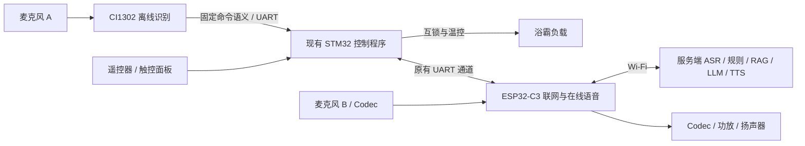

# CI1302 经 STM32 接入与在线离线协同 V1.0

更新日期：2026-10-31  
状态：设计基线；STM32/C3 扩展代码已实现并通过构建，整机时序与负载实测待完成。实施步骤和剩余门禁以《样机联调与云端试点执行清单 V1.0》为准。

## 1. 接入结构



CI1302 接 STM32 预留串口，不再占用 C3 的第二组 UART。现有接线由东信技术人员确认为 CI TX → STM32 PB11（USART3 RX），共同地；PB10 是 STM32 TX，当前不向 CI 发送旧 RS485 业务帧。CI 词码帧已在独立开发板上以 9600 bps、8N1 实测；整机接线电平和供电仍须按样板原理图复核。C3 与 STM32 现有连接保留，GPIO18 为 C3 TX、GPIO19 为 C3 RX。

CI1302 负责唤醒和有限的固定命令，不要求输出原始 PCM 或任意自然语言文本。在线音频仍由 C3 独立麦克风和 Codec 提供。两个模拟麦克风不直接并联。

## 2. 控制分工

| 输入 | 处理位置 | 联网时 | 断网或 C3 异常时 |
|---|---|---|---|
| CI1302 固定命令 | STM32 | 本地执行，不重复调用在线 AI | 继续本地执行 |
| 遥控器、触控面板 | STM32 | 本地执行 | 继续本地执行 |
| 开放式语音、企业知识问答 | C3 与服务端 | ASR → 规则/知识库/LLM → TTS | 不提供在线回答 |
| 在线结构化设备指令 | STM32 最终执行 | 经安全校验及控制序号检查 | 超时丢弃，不积压重放 |

设备始终保留本地安全互锁。在线状态不作为禁用 CI1302 的条件。固定命令命中后不再开启同一句的在线控制；开放问题只在未命中固定命令且在线会话条件满足时进入 C3 录音。当前 C3 在 CI 唤醒后的连续会话中，每句话结束时都留出固定词识别窗口，再完成在线音频上传；固定词事件到达则取消对应在线句，但不结束整轮会话，随后继续监听直至空闲超时或用户结束对话。窗口设为 700 ms，实际取值需经整机时序和噪声测试确认。C3 在等待固定词判定时可能已将音频写入尚未结束的 HTTP 请求，只有确认未命中后才结束请求并进入云端 ASR；固定词命中时直接关闭该请求。若本地事件与在线回复交错，C3 用录音时的事件版本拒绝过期回复及播放；若事件晚于等待窗且 HTTP 已进入同步等待，恢复监听仍可能受请求超时影响，需在整机上量测。

“小东小东”唤醒后由 CI 播放一次“我在”，C3 对经 CI 唤醒的会话不重复播报。首版保持半双工：C3 自身播放期间不接收新的在线录音。CI 播报与 C3 麦克风并非同一硬件开关；若 ASR 把 CI 播报识别为“我在”，服务端会丢弃该句，不调用 LLM/TTS，也不写入后续对话上下文，但该次 ASR 仍可能产生费用。更早的声学抑制和双麦回声表现必须实测，不能仅凭软件判断保证。CI 的未命中、唤醒结束等事件是否可直接取得，需以实际固件确认；若没有未命中事件，应由唤醒窗口及固定命令等待超时触发在线采集，具体时间在实物联调时确定。

## 3. STM32 侧扩展要求

1. CI 厂商命令码先映射为项目语义，再调用现有控制入口，避免重写负载控制。
2. 每次有效本地操作推进设备控制序号，包括“本来已关，再次关闭”等状态不变的操作。
3. 同一唤醒窗口或话语使用关联编号；固定命令执行后关闭该窗口的在线控制入口。C3 已有在途录音时，取消该话语的上传或丢弃响应。
4. C3 发起在线控制时携带所依据的控制序号；STM32 在执行前比较当前序号，旧序号不执行。服务端和 C3 另外限制命令有效期，当前 32 字节 MCU 帧没有独立的过期时间字段，不能把 STM32 过期校验视作已实现。
5. 先完成本地动作，再回传来源、执行结果及真实状态。上报失败不能阻塞本地控制。
6. 各来源共用现有互锁、故障保护和负载控制入口；独立超温保护仍须由硬件与 STM32 保证。

现有 C3 ↔ STM32 的 115200 bps、8N1、32 字节帧保持现状。后续代码已在原帧预留字节定义 CI 事件和控制版本，详见当前固件及《样机联调与云端试点执行清单 V1.0》；这不是本文件最初形成时的状态。实物误码、版本兼容及跨端时序尚需验证。

2026-11-02 软件更新：已核对实际烧录包 `D:\workspace\sfw20261030143307184745150\readme.txt` 中的 V0.4 词码。STM32 接收白名单现为 ID 1（唤醒）、2/3（照明开/关）、8/9（换气开/关）、10/11（吹风开/关），C3 的事件解码与云端意图记录使用相同映射。4–7 是取暖词码，仍拒绝执行；其他未验证词码也拒绝。代码已构建，尚未烧录或实物验证新增动作。通过 STM32 原 32 字节链路上报唤醒和本地执行事件及 8 位控制序号。C3 对重复 CI 事件做短窗去重，但仍从重复状态帧更新设备状态。STM32 的回传反映其控制程序所记录的状态；负载是否真实动作、执行完成到回传的时差尚未测得。CI 原生未命中事件和窗口编号尚未实测。

## 4. 已实现的服务端接口

`POST /api/device/v1/events` 接受 `LOCAL_CONTROL` 事件；MQTT 的设备 `up/event` 通道可承载相同请求体。MQTT 仍使用现有 envelope 和设备主题校验。

```json
{
  "deviceId": "设备标识",
  "eventId": "启动编号-递增事件序号",
  "eventType": "LOCAL_CONTROL",
  "occurredAt": "2026-10-28T08:00:00Z",
  "payload": {
    "source": "CI1302",
    "intent": "LIGHT_OFF",
    "state": { "light": "off" }
  }
}
```

- `source` 仅接受 `CI1302`、`REMOTE`、`PANEL`；`eventId` 必填，长度不超过128字符。
- `intent`、`state` 可选。只依据实际回传状态更新设备，不把意图直接当作执行成功。
- 服务端收到有效事件后推进本进程控制版本，使此前的在线控制及待确认命令失效；无状态变化的本地操作也生效。
- C3 为首次观察到的本地动作生成一个事件编号，断线暂存与 MQTT 重传沿用该编号；重连时先取得本地事件的 QoS 1 发布确认，再等待四个下行主题的订阅确认，然后处理新下行。断线前排队的旧代次下行不跨连接执行。离线暂存只保留最近一次 CI 状态，恢复后完整状态上报用于对账，不保证逐条补齐离线期间的所有动作流水。暂存仅在内存中，C3 在断网期间掉电仍可能丢失事件，不能把它等同于持久化审计。
- 当前运行中服务端对同一设备同一事件编号在60秒内复用结果；同编号不同内容返回冲突。窗口有2048条及1MB响应上限，满载返回429；它不提供跨重启的永久去重。PostgreSQL 已准备事件编号唯一索引和原子去重仓储，但业务入口尚未切换，不能声称跨重启去重已上线。
- 部分状态仅覆盖明确上报的字段，关灯不会清除已有风机或取暖状态。
- 服务端控制版本仍是进程内保护；设备端控制序号和事件回传已写入 STM32/C3 代码但未烧录联调，不能据此宣称硬件仲裁已验收。

## 5. 后续接入与验证顺序

1. 确认 CI1302 模块实际资源工程、串口输出码及 STM32 预留接口；断电完成接线。
2. STM32 接收 CI 固定命令，先以串口日志或无负载状态验证，再由研发人员操作样机。
3. 验证断网、C3断开及服务端停止时，本地固定命令仍可执行。核对断线前后同一动作的 `eventId` 不变化，以及重连补报在下行订阅之前发起；MQTT QoS 1 重传下云端不得把同一动作记成两次。此顺序目前仅通过代码构建和静态检查，未完成真实 broker/设备时序验收。
4. 实现并验证 STM32 → C3 协同事件及控制序号扩展，再接入本文服务端接口。
5. 验证同一句只执行一次、在线回答期间本地关闭优先、网络恢复不重放旧控制；最后验证双麦与播放回声影响。

本轮没有进行以上实物测试，未形成 CI1302 唤醒率、离线识别率、串口稳定性或热安全结论。
