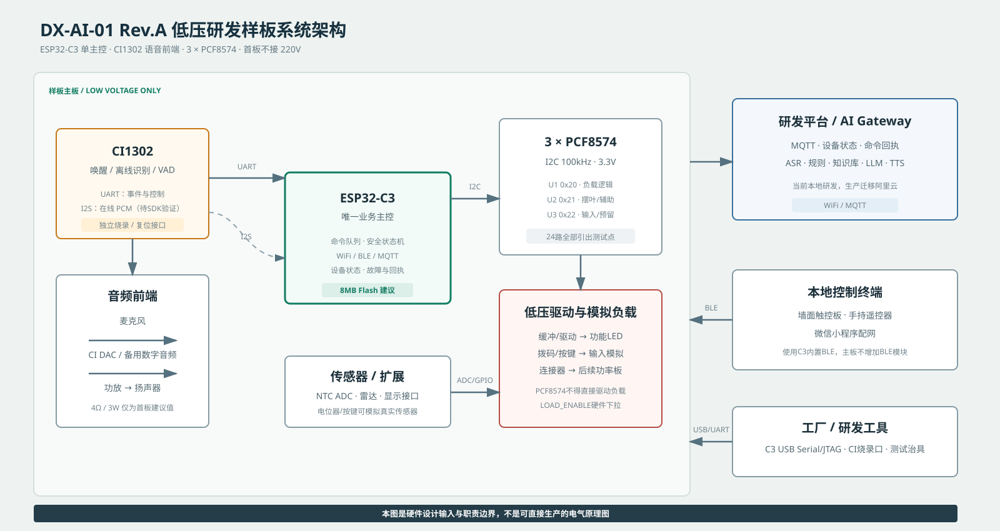
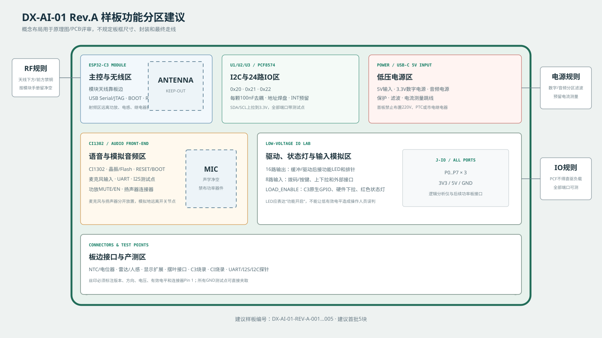
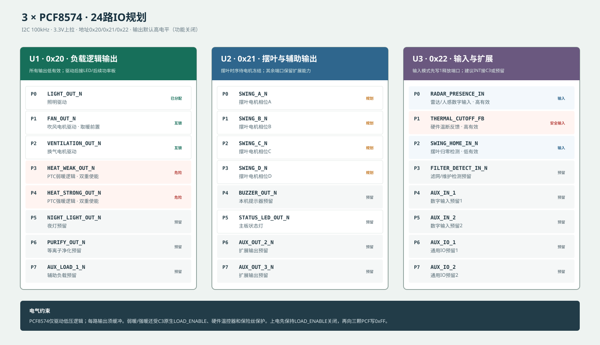
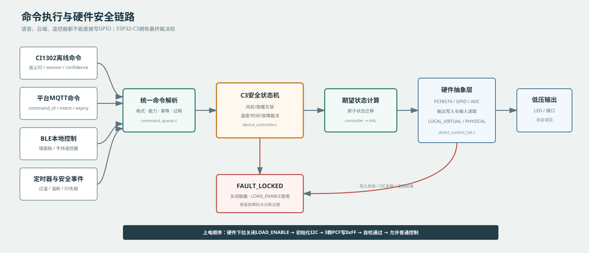

# DX-AI-01 Rev.A 硬件设计输入书 V1.0

| 项目 | 内容 |
|---|---|
| 产品 | 东信AI浴霸控制与语音系统 |
| 板卡 | DX-AI-01 Mainboard Rev.A |
| 文档性质 | 首版低压研发样板的硬件设计输入，不是最终电气原理图 |
| 交付对象 | 东信硬件、PCB、结构、测试及供应链人员 |
| 文档状态 | 设计输入基线，投板前必须完成原理图联合评审 |
| 软件基线 | Git提交 `6db35f4`，后续以发布记录为准 |
| 更新日期 | 2026-09-15 |

## 1. 文档目的

本文把系统架构、芯片职责、板级接口、24路IO、音频、电源、安全状态和样板验收统一为一份硬件设计输入。东信硬件人员应依据本文完成原理图和PCB设计，再把可编辑工程、原理图PDF、BOM和实际GPIO表返回软件侧评审。

本文不能替代以下工程工作：

- ESP32-C3、CI1302及音频器件的官方参考设计审查；
- 电源完整性、射频、声学、EMC、ESD和热设计；
- 真实风机、PTC、继电器、可控硅和220V电气安全设计；
- 最终整机结构、认证和量产可靠性验证。

首版目标是快速完成低压软硬件闭环，不允许把尚未确认的GPIO、音频方向或负载参数自行推断后直接投板。

## 2. Rev.A范围与冻结决定

### 2.1 已冻结

| 决定 | Rev.A要求 |
|---|---|
| 业务主控 | ESP32-C3是唯一业务主控，不再配置传统浴霸MCU |
| 语音前端 | CI1302负责“小东小东”唤醒、固定命令、VAD、麦克风前端和本地提示音 |
| IO扩展 | 3颗PCF8574，共24路，地址固定为`0x20/0x21/0x22` |
| 无线 | WiFi和BLE使用ESP32-C3内置能力，主板不增加外部BLE模块 |
| 控制边界 | 平台、CI1302和BLE终端只发送语义命令，不能直接操作GPIO |
| 安全裁决 | C3本地状态机拥有最终动作裁决权 |
| 上电状态 | 所有负载关闭；危险负载总使能`LOAD_ENABLE`硬件下拉 |
| 调试方式 | C3和CI1302分别保留烧录/调试入口，不能共用一个不可切换串口 |
| 数据 | 状态变化立即上报，低频心跳；原始音频不落库 |

### 2.2 首板建议值

| 项目 | 建议值 | 说明 |
|---|---|---|
| 样板数量 | 5块 | 每块具有唯一板号和装配记录 |
| 样板供电 | USB-C或端子5V DC，建议能力不低于2A | 具体能力按功放和扬声器重新核算 |
| C3形态 | 首板优先使用带天线的ESP32-C3模组 | 稳定优先；量产再评估裸芯片降本 |
| Flash | 建议8MB | 预留双OTA、NVS、诊断和资源空间；具体模组后缀须在BOM中明确 |
| 扬声器 | 4Ω/3W作为首板评估基线 | 必须与功放、结构声腔和实际声压目标联合选型 |
| 真实负载 | 不装配 | 用LED、开关、电位器和低压接口模拟 |
| 屏幕/触摸 | 预留标准扩展接口 | 型号未冻结前不直接占用大量PCF端口 |
| 雷达 | 数字存在信号接U3-P0，另预留UART扩展 | 模组型号冻结后选择最终接口 |

### 2.3 明确不在Rev.A实现

- 220V输入和市电功率驱动；
- 真实PTC取暖和真实风机无人值守运行；
- 未选型显示屏的最终驱动电路；
- 未取得热测试数据前的量产温控阈值；
- 未验证CI1302 SDK前对双向I2S能力作量产承诺。

## 3. 系统架构



### 3.1 芯片职责

| 模块 | 负责 | 不负责 |
|---|---|---|
| ESP32-C3 | WiFi/BLE、MQTT、命令队列、安全状态机、设备状态、PCF/GPIO/ADC、在线语音编排 | 麦克风模拟前端、直接驱动220V负载 |
| CI1302 | 唤醒、离线识别、VAD、麦克风前端、本地提示音、音频能力 | 设备安全裁决、直接控制负载、联网业务 |
| PCF8574 | 低速低压数字IO扩展 | 电机、继电器、功放或LED阵列的直接功率驱动 |
| AI平台 | ASR、规则、知识库、LLM、TTS、设备管理 | 绕过C3状态机直接写硬件 |
| BLE终端 | 墙面板/手持遥控器命令、配对和状态显示 | 直接持有PCF端口含义 |

## 4. 样板功能分区



硬件人员可以调整板框和器件位置，但必须遵守以下布局边界：

1. C3模组天线靠板边，按模组手册保留天线下方和前方禁布区；
2. 天线远离功放、电源电感、扬声器大电流线和后续负载接口；
3. 麦克风周围不放置DC/DC、功放、电机驱动或高速时钟器件；
4. 数字电源、CI模拟音频和功放电源分区滤波，在推荐位置单点/完整地平面连接；
5. USB、C3调试、CI烧录、音频和全部IO测试点应位于探针可访问位置；
6. 连接器Pin 1、电压、方向、板号和版本号必须有清晰丝印；
7. 未装配功能使用DNP/0Ω配置，不使用飞线作为首板默认设计方案。

建议按以下原理图Sheet拆分：

| Sheet | 内容 |
|---|---|
| 01_POWER | 5V输入、保护、3.3V、音频电源、测流跳线和电源测试点 |
| 02_ESP32_C3 | C3模组、天线净空、BOOT/RESET、USB、原生安全GPIO |
| 03_CI1302_AUDIO | CI1302、时钟/存储、麦克风、UART、I2S、功放和扬声器 |
| 04_PCF8574_IO | 三颗PCF8574、地址、上拉、缓冲、LED、输入模拟和IO排针 |
| 05_SENSOR_EXP | NTC、雷达、显示扩展、摆叶接口和预留接口 |
| 06_TEST | 产测点、连接器总表、板号和调试说明 |

## 5. ESP32-C3原生接口需求

当前软件没有冻结量产板GPIO编号。硬件人员必须先提交一版实际引脚建议，软件侧根据ESP32-C3模组、启动绑带、USB、Flash和外设复用约束确认后，才能将`TBD`改为`FROZEN`。

| 网络名 | 数量 | 方向 | 电气/默认 | 连接目标 | 状态 |
|---|---:|---|---|---|---|
| `PCF_I2C_SDA` | 1 | 双向 | 3.3V开漏，外部上拉 | U1/U2/U3 SDA | GPIO TBD |
| `PCF_I2C_SCL` | 1 | 输出/双向 | 3.3V开漏，外部上拉 | U1/U2/U3 SCL | GPIO TBD |
| `PCF_INT` | 1 | 输入 | 开漏中断，3.3V上拉 | 至少连接U3 INT；可线与 | 建议预留 |
| `LOAD_ENABLE` | 1 | 输出 | 硬件下拉；低电平=禁用，高电平=使能 | 后续危险负载总使能/首板红灯 | 必须保留 |
| `NTC_ADC` | 1 | 模拟输入 | 0至3.3V，RC滤波 | NTC分压/测试电位器 | ADC TBD |
| `CI_UART_TX` | 1 | 输出 | 3.3V TTL，空闲高 | CI1302 RX | GPIO TBD |
| `CI_UART_RX` | 1 | 输入 | 3.3V TTL，空闲高 | CI1302 TX | GPIO TBD |
| `CI_I2S_BCLK` | 1 | 待验证 | 3.3V数字 | CI1302 | GPIO/方向 TBD |
| `CI_I2S_WS` | 1 | 待验证 | 3.3V数字，16kHz帧 | CI1302 | GPIO/方向 TBD |
| `CI_I2S_DIN` | 1 | 输入候选 | 3.3V数字 | CI麦克风PCM到C3 | GPIO/能力 TBD |
| `CI_I2S_DOUT` | 1 | 输出候选 | 3.3V数字 | C3 TTS PCM到CI | GPIO/能力 TBD |
| `FACTORY_USB` | 2 | 双向 | USB D+/D- | 烧录、日志、产测 | 按模组固定脚 |
| `C3_NATIVE_SPARE` | 至少1 | 双向 | 3.3V | 高速、中断或补充接口 | 必须预留测试点 |

### 5.1 GPIO评审规则

- 不占用模组内部Flash连接；
- 启动绑带脚不能被外设强拉到错误电平；
- USB Serial/JTAG调试能力在研发样板上保持可用；
- C3复位期间`LOAD_ENABLE`必须由硬件保证关闭，不依赖软件；
- CI业务UART与C3启动日志物理隔离，或提供明确跳线/开关；
- I2S和UART的实际GPIO以ESP-IDF目标配置能够同时初始化为验收条件；
- 所有未使用原生GPIO至少保留焊盘，不能在原理图中无说明消失。

## 6. PCF8574 24路IO



### 6.1 I2C电气要求

- 三颗器件均工作在3.3V域，A0/A1/A2固定配置成`0x20/0x21/0x22`；
- SDA/SCL按总线电容计算上拉，首板建议预留多组阻值焊盘，不直接假定最终阻值；
- 总线初始速率100kHz，每颗器件就近配置100nF去耦；
- SDA、SCL、每颗INT、VCC和GND均提供测试点；
- PCF8574为准双向端口，作为输入使用前必须先向对应位写1释放端口；
- 上电后软件先保持`LOAD_ENABLE`关闭，再探测三颗地址并写`0xFF`；
- 任一PCF失联、写入失败或状态异常时，危险负载保持关闭并上报`E003`；
- PCF端口不得直接连接220V、继电器线圈、电机、功率管栅极长线或大电流LED。

### 6.2 端口定义

| 芯片/地址 | 端口 | 网络名 | 方向/有效 | 首板表现 | 状态 |
|---|---|---|---|---|---|
| U1/0x20 | P0 | `LIGHT_OUT_N` | 输出/低有效 | 缓冲后“照明”LED + 排针 | 已分配 |
| U1/0x20 | P1 | `FAN_OUT_N` | 输出/低有效 | 缓冲后“吹风”LED + 排针 | 已分配/互锁 |
| U1/0x20 | P2 | `VENTILATION_OUT_N` | 输出/低有效 | 缓冲后“换气”LED + 排针 | 已分配/互锁 |
| U1/0x20 | P3 | `HEAT_WEAK_OUT_N` | 输出/低有效 | 缓冲后“弱暖”红灯 + 排针 | 危险逻辑 |
| U1/0x20 | P4 | `HEAT_STRONG_OUT_N` | 输出/低有效 | 缓冲后“强暖”红灯 + 排针 | 危险逻辑 |
| U1/0x20 | P5 | `NIGHT_LIGHT_OUT_N` | 输出/低有效 | “夜灯”LED + 排针 | 预留 |
| U1/0x20 | P6 | `PURIFY_OUT_N` | 输出/低有效 | “净化”LED + 排针 | 预留 |
| U1/0x20 | P7 | `AUX_LOAD_1_N` | 输出/低有效 | “AUX1”LED + 排针 | 预留 |
| U2/0x21 | P0 | `SWING_A_N` | 输出/低有效 | 相位A LED + 电机接口 | 规划 |
| U2/0x21 | P1 | `SWING_B_N` | 输出/低有效 | 相位B LED + 电机接口 | 规划 |
| U2/0x21 | P2 | `SWING_C_N` | 输出/低有效 | 相位C LED + 电机接口 | 规划 |
| U2/0x21 | P3 | `SWING_D_N` | 输出/低有效 | 相位D LED + 电机接口 | 规划 |
| U2/0x21 | P4 | `BUZZER_OUT_N` | 输出/低有效 | LED/有源提示器DNP | 预留 |
| U2/0x21 | P5 | `STATUS_LED_OUT_N` | 输出/低有效 | 主板状态LED | 预留 |
| U2/0x21 | P6 | `AUX_OUT_2_N` | 输出/低有效 | “AUX2”LED + 排针 | 预留 |
| U2/0x21 | P7 | `AUX_OUT_3_N` | 输出/低有效 | “AUX3”LED + 排针 | 预留 |
| U3/0x22 | P0 | `RADAR_PRESENCE_IN` | 输入/高有效 | 按键/拨码 + 雷达接口 | 规划 |
| U3/0x22 | P1 | `THERMAL_CUTOFF_FB` | 输入/高有效 | 安全拨码 + 外部接口 | 安全输入 |
| U3/0x22 | P2 | `SWING_HOME_IN_N` | 输入/低有效 | 按键 + 电机零位接口 | 规划 |
| U3/0x22 | P3 | `FILTER_DETECT_IN_N` | 输入/低有效 | 拨码 + 外部接口 | 预留 |
| U3/0x22 | P4 | `AUX_IN_1` | 输入/TBD | 拨码 + 排针 | 预留 |
| U3/0x22 | P5 | `AUX_IN_2` | 输入/TBD | 拨码 + 排针 | 预留 |
| U3/0x22 | P6 | `AUX_IO_1` | 输入优先/TBD | 拨码 + 排针 | 预留 |
| U3/0x22 | P7 | `AUX_IO_2` | 输入优先/TBD | 拨码 + 排针 | 预留 |

本表给出原理图物理网络名，后缀`_N`明确表示低有效。研发平台和固件的机器可读配置使用不带`_N`的语义名并单独记录`activeLevel=LOW`，例如原理图`LIGHT_OUT_N`对应软件`LIGHT_OUT + LOW`；硬件设计不得据此改变端口或有效电平。

输出LED必须表达“功能开启”，不能简单按引脚高低接灯导致低有效时视觉含义相反。建议使用统一缓冲/反相驱动并在丝印标记逻辑名称。

## 7. CI1302与音频设计

### 7.1 控制接口

| 项目 | 要求 |
|---|---|
| 逻辑电平 | 3.3V TTL，禁止5V直连C3 |
| UART | 115200bps、8N1、无流控 |
| 应用协议 | `CIDX`帧头、序号、长度、CRC16、ACK/NACK、超时重试 |
| 事件 | HELLO、WAKE、VAD_START、VAD_END、OFFLINE_COMMAND、OFFLINE_MISS、PLAY_FINISHED、FAULT |
| 烧录 | 使用CI官方烧录流程，保留独立BOOT/RESET/烧录接口 |
| 故障隔离 | CI故障时C3、BLE、MQTT和基本控制继续工作 |

### 7.2 音频通路投板门禁

以下能力必须由CI1302 SDK、官方例程或启英泰伦技术支持确认：

1. CI是否能持续输出麦克风或降噪后的16kHz/16bit/单声道PCM；
2. 输出接口是否确为I2S，BCLK/WS/DATA的主从和方向；
3. CI是否能接收C3返回的任意TTS PCM并通过其DAC播放；
4. 录音与播放切换、静音、缓存和PLAY_FINISHED事件如何实现；
5. C3和CI能否可靠共用一套麦克风、功放和扬声器。

首板必须使用0Ω/DNP配置和完整测试点，使以下两条路线至少可以保留一条：

| 路线 | 说明 | 当前状态 |
|---|---|---|
| A，优先 | 麦克风 → CI1302 → I2S PCM → C3；C3 TTS PCM → CI1302 DAC → 功放 → 扬声器 | 待SDK验证 |
| B，备选 | 麦克风仍由CI负责；C3 TTS通过独立数字音频DAC/功放播放 | 首板预留，不默认装配 |

### 7.3 音频硬件资料

东信硬件设计必须在BOM和原理图中明确：

- CI1302完整料号、封装、时钟、外部Flash/资源存储和推荐去耦；
- 麦克风类型、数量、灵敏度、偏置、输入滤波、连接方式和声学位置；
- 功放完整料号、供电、输入方式、增益、EN/MUTE默认状态和防爆音策略；
- 扬声器阻抗、额定功率、连接器、线长和结构声腔要求；
- UART和I2S串联电阻/0Ω配置以及全部测试点；
- 麦克风到扬声器的距离、开孔方向和防水声学材料。

功放`EN/MUTE`必须有硬件默认静音状态，C3/CI启动稳定后再开启，避免上电爆音。

## 8. BLE、本地终端与扩展接口

### 8.1 BLE边界

- 主板使用C3内置BLE，不增加外部BLE接收芯片；
- 墙面触控板和手持遥控器是独立BLE终端，需要各自的电源、按键、芯片/模组和固件；
- BLE终端发送语义命令，不发送GPIO或PCF端口号；
- 首次绑定、断线重连、长按、重复按键和状态回执按BLE协议V1.0执行；
- 主板天线和整机金属结构必须进行实际距离、遮挡和共存测试。

### 8.2 建议扩展连接器

| 接口 | 建议引脚 | 用途 |
|---|---|---|
| `J_NTC` | 3V3、GND、NTC_ADC | 实际NTC；板上另装电位器/跳线切换 |
| `J_RADAR` | 5V、3V3、GND、PRESENCE、UART_TX、UART_RX | 兼容数字输出或UART雷达；具体电压由模组冻结 |
| `J_DISPLAY` | 5V、3V3、GND、SDA、SCL、TX、RX、IRQ | 显示/触摸扩展；地址冲突必须评审 |
| `J_SWING` | 供电、GND、A/B/C/D、HOME | 首板LED模拟，后续连接电机驱动板 |
| `J_LOAD` | U1全部输出、LOAD_ENABLE、3V3、5V、GND | 后续低压驱动/功率板接口 |
| `J_AUX_IO` | U2/U3预留端口、3V3、5V、GND | 常见浴霸附加能力 |

显示屏未选型前不建议用PCF8574直接扫描多位数码管。应先预留I2C/UART接口，屏幕型号冻结后选择专用显示驱动。

## 9. 电源与电气要求

### 9.1 首板电源树

| 电源域 | 负载 | 设计要求 |
|---|---|---|
| `5V_IN` | 功放、外部接口、3.3V电源输入 | USB-C/端子输入，反接/过流/ESD保护，建议能力不低于2A |
| `3V3_DIG` | C3、PCF8574、数字接口 | 按C3 WiFi峰值和全部数字负载核算，建议稳压能力不低于1A |
| `3V3_CI/AUDIO` | CI1302和麦克风前端 | 按官方参考设计滤波；必要时从数字域经磁珠/独立LDO供电 |
| `AMP_VDD` | Class-D功放 | 独立去耦和储能，回流不穿越麦克风/天线区域 |

实际电源芯片和容量由硬件工程师计算并在原理图评审中提交依据。所有电源域至少配置一个测试点；建议增加可断开的0Ω/电流测量跳线，方便分别测量C3、CI和功放电流。

### 9.2 Rev.A安全限制

- 板上和连接器不得出现220V；
- LED、提示器和外部低压接口必须经过限流/缓冲；
- 外部5V信号进入3.3V域前进行电平转换或限压；
- USB接口具有ESD保护和正确的USB-C CC配置；
- 所有外部连接器提供明确地线并避免反插；
- 首板不得依靠软件实现唯一的过流、过温或危险负载关断。

## 10. 上电、复位与故障行为



### 10.1 强制上电顺序

```text
5V/3.3V建立
  → LOAD_ENABLE由硬件下拉保持关闭
  → PCF8574端口自然释放为高，驱动级保持功能关闭
  → C3完成复位、NVS、看门狗和日志初始化
  → 初始化I2C并探测0x20/0x21/0x22
  → 三颗PCF写入0xFF
  → 初始化NTC、CI1302、BLE和WiFi
  → 自检通过后进入STANDBY
```

### 10.2 故障结果

| 故障 | 硬件/固件动作 |
|---|---|
| C3复位、看门狗或未启动 | `LOAD_ENABLE`硬件保持关闭，PCF危险逻辑不得误动作 |
| 任一PCF失联 | 拉低/关闭`LOAD_ENABLE`，全部取暖输出关闭，记录`E003` |
| NTC开路、短路或越界 | 关闭取暖并锁定`E001` |
| 软件过温 | 关闭取暖，按安全条件保持散热，锁定`E002` |
| 硬件温断触发 | 无条件关闭取暖，不允许语音或云端清除 |
| CI1302故障 | 禁用语音；BLE、MQTT和安全控制继续 |
| WiFi/MQTT断开 | 本地语音固定命令和BLE控制继续 |
| 功放/音频异常 | 静音功放，不影响设备控制 |

## 11. 测试点与丝印

### 11.1 必须测试点

| 类别 | 测试点 |
|---|---|
| 电源 | 5V_IN、3V3_DIG、3V3_CI/AUDIO、AMP_VDD、多个GND |
| C3 | EN/RESET、BOOT、USB D+/D-或调试口、LOAD_ENABLE、NTC_ADC、C3备用GPIO |
| I2C | SDA、SCL、U1/U2/U3 INT、三颗地址焊盘 |
| CI | CI_TX、CI_RX、RESET、BOOT、I2S BCLK/WS/DIN/DOUT、CI烧录口 |
| IO | 24个PCF端口或可逐路探测的排针 |
| 音频 | MIC_BIAS/输入、DAC/数字音频输入、AMP_EN/MUTE、扬声器输出（差分输出不得对地短接） |

### 11.2 丝印规则

- 板名：`DX-AI-01`；版本：`REV.A`；唯一板号：`001…005`；
- 每个连接器明确Pin 1、VCC电压、GND和信号方向；
- 低有效信号使用`_N`或在丝印标注`LOW=ON`；
- 危险逻辑使用红色或显著警告标识；
- `5V`与`3V3`不得使用容易混淆的相同接口；
- 天线禁布区、麦克风声孔和扬声器极性必须标识。

## 12. 首板验收计划

| 序号 | 验收项 | 方法 | 通过条件 |
|---:|---|---|---|
| 1 | 外观/BOM | 对照原理图、BOM、位号和板号 | 5块样板可追溯，无错件反件 |
| 2 | 静态电源 | 限流电源上电，分别测5V/3.3V/音频域 | 电压和静态电流在设计范围，无异常发热 |
| 3 | 安全上电 | 反复上电、复位、BOOT和看门狗测试 | 所有负载灯关闭，LOAD_ENABLE始终默认关闭 |
| 4 | C3烧录 | 使用标准脚本烧录和查看日志 | 5块均能稳定烧录、启动和输出版本 |
| 5 | I2C扫描 | 扫描总线并读写三颗PCF | 稳定发现0x20、0x21、0x22，无额外冲突 |
| 6 | 16路输出 | 平台/测试固件逐路开关 | 正确LED和排针动作，无串扰，低有效含义正确 |
| 7 | 8路输入 | 逐个拨码/按键和外部输入 | 状态正确、无悬空抖动、中断/轮询可靠 |
| 8 | 故障注入 | 断开任一PCF、模拟温断和NTC异常 | 进入故障，危险输出关闭并产生正确故障码 |
| 9 | CI UART | HELLO、心跳、唤醒、离线命令、未命中 | CRC/ACK/重试正确，断链可恢复 |
| 10 | 麦克风 | 固定距离和噪声下录制PCM/识别 | 无明显底噪、削波和电源干扰 |
| 11 | 功放/扬声器 | 播放提示音和在线TTS | 无爆音、异常失真，MUTE/EN有效 |
| 12 | BLE | 墙面板/遥控器配对、命令、重连 | 命令不重复、回执正确、断电可恢复 |
| 13 | NTC/雷达 | 电位器扫描、按键及真实模组接口 | ADC连续稳定，数字状态变化正确 |
| 14 | 网络闭环 | WiFi/MQTT连接、命令、状态、回执 | C3实板执行链为APPLIED，状态一致 |
| 15 | 稳定性 | 8小时功能循环、24小时联网 | 无崩溃、异常复位、持续内存下降或总线锁死 |

本轮验收只证明低压控制和音频链路，不代表220V负载、温升、EMC或整机认证通过。

## 13. 投板门禁

以下任一项未满足，Rev.A不得投板：

| 门禁 | 必须证据 |
|---|---|
| C3完整料号冻结 | BOM标明模组/芯片完整后缀、Flash容量和天线形式 |
| C3 GPIO冻结 | 原理图和独立引脚表无未解释冲突，启动/USB/Flash约束已审查 |
| LOAD_ENABLE安全 | 原理图证明硬件下拉，复位时关闭，不由PCF单点控制 |
| PCF地址与驱动 | 0x20/0x21/0x22固定，端口有缓冲，无直接驱动负载 |
| CI参考设计 | 数据手册/官方参考设计/BOM完成核对，独立烧录可用 |
| 音频路线可调 | I2S方向已确认，或通过0Ω/DNP保留可验证备选路线 |
| 电源预算 | 提供各电源域峰值、稳态、裕量和功放瞬态计算 |
| 测试能力 | 关键测试点、输入模拟、输出LED和板号齐全 |
| 射频/声学边界 | 天线净空、麦克风声孔和功放噪声隔离已审查 |
| 联合评审 | 软件、东信硬件和测试负责人在评审记录中签字/确认 |

## 14. 东信投板前返还资料

硬件人员不能只返回一张截图或PDF。必须返回：

1. 原理图PDF及可编辑工程源文件；
2. PCB工程、板框、层叠和关键布局截图；
3. 完整BOM，含厂家、完整料号、封装、数量、替代料和DNP状态；
4. 实际ESP32-C3 GPIO表，逐项对应本文网络名；
5. PCF8574地址焊盘和24路端口映射；
6. CI1302官方参考资料核对结果及UART/I2S能力映射；
7. 麦克风、功放、扬声器选型和音频增益/功率计算；
8. 电源树、功耗预算和保护器件说明；
9. 所有连接器和测试点表；
10. ERC/DRC结果、已知风险和未关闭问题；
11. 样板数量、预计交期、贴片范围和每块板的唯一编号；
12. 东信硬件负责人、测试负责人和后续220V安全负责人。

软件侧收到资料后执行：原理图审查 → GPIO冻结 → 更新`board_profile`和`app_config` → 编译样板固件 → 低压台架验收。不得先投板再要求软件适配冲突引脚。

## 15. 交付目录建议

```text
DX-AI-01_RevA_Hardware_Package/
├── 00_硬件设计输入书/
│   └── DX-AI-01 Rev.A硬件设计输入书 V1.0.pdf
├── 01_原理图/
│   ├── DX-AI-01_RevA_Schematic.pdf
│   └── Editable_Source/
├── 02_PCB/
│   ├── DX-AI-01_RevA_PCB.pdf
│   └── Editable_Source/
├── 03_BOM与器件资料/
├── 04_引脚与接口表/
├── 05_CI1302与音频/
├── 06_固件与烧录/
├── 07_测试与验收/
└── 08_评审记录与变更/
```

## 16. 变更控制

- 板卡、C3固件、CI固件、CI资源包和协议分别维护版本号；
- GPIO、PCF端口、有效电平、连接器Pin序或电源电压变化均属于硬件接口变更；
- 任何接口变更必须先更新本文和板卡定义，再更新原理图/固件；
- 密钥、WiFi密码和生产凭证不得写入通用源码、原理图备注或量产公共bin；
- 样板测试记录必须包含板号、Git提交、固件版本、CI版本和测试人员。

## 17. 关联资料

- [C3单主控系统架构与职责边界 V1.0](C3单主控系统架构与职责边界%20V1.0.md)
- [ESP32-C3与CI1302通信协议 V1.0](ESP32-C3与CI1302通信协议%20V1.0.md)
- [ESP32-C3与BLE本地控制终端协议 V1.0](ESP32-C3与BLE本地控制终端协议%20V1.0.md)
- [浴霸控制状态机与安全规则 V1.0](浴霸控制状态机与安全规则%20V1.0.md)
- [MQTT设备通信协议 V1.0](MQTT设备通信协议%20V1.0.md)
- [东信技术交付文件清单 V1.0](东信技术交付文件清单%20V1.0.md)
- [机器可读板卡定义](../data/board-profiles.json)

## 18. 评审确认

| 角色 | 姓名 | 结论 | 日期 |
|---|---|---|---|
| 软件负责人 |  | 通过 / 有条件通过 / 退回 |  |
| 东信硬件负责人 |  | 通过 / 有条件通过 / 退回 |  |
| 东信测试负责人 |  | 通过 / 有条件通过 / 退回 |  |
| 东信项目负责人 |  | 同意投板 / 不同意投板 |  |

评审遗留问题必须给出负责人、截止时间和是否阻塞投板，不接受仅口头确认。
