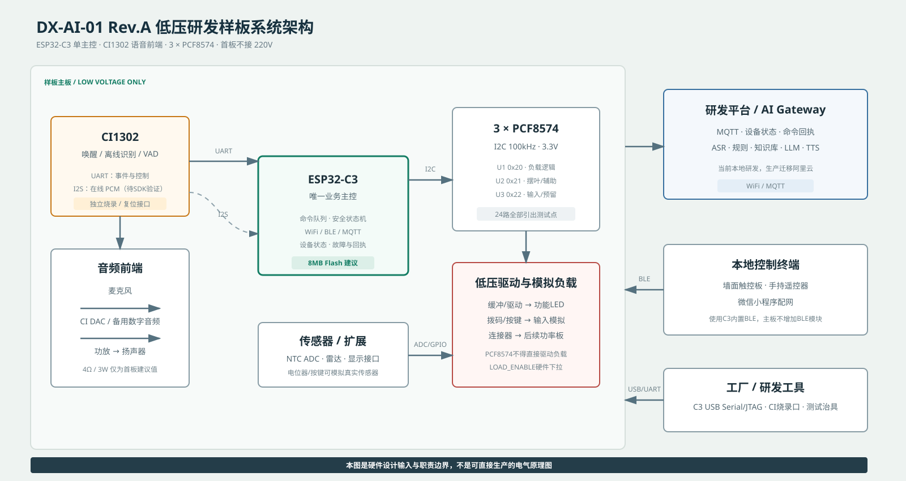

# ESP32-C3固件软件设计说明 V1.0

> 状态：部分内容已由 STM32 + C3 架构替代。当前固件职责和安全限制以《项目执行基线 V1.1》及 `firmware/README.md` 为准。

| 项目 | 内容 |
|---|---|
| 文档编号 | DX-RD-SDD-001 |
| 适用产品 | DX-AI-01 |
| 文档版本 | V1.0 |
| 文档状态 | 评审基线 |
| 软件基线 | Git `e4f72d00441dbd233f931b609d9203a7aceff13c` |
| 编制日期 | 2026-09-22 |

## 1. 目的与范围

本文规定DX-AI-01中ESP32-C3固件的软件分层、模块职责、启动流程、任务模型、控制路径、安全处理和板级配置。本文用于固件评审、样板适配、缺陷定位和后续量产版本维护。

本文描述当前软件基线及已确定的量产架构。尚未取得样板或器件参数的功能均标记为待验证，不构成真实负载验收结论。

## 2. 规范性引用文件

- [项目范围与技术决策基线 V1.0](项目范围与技术决策基线%20V1.0.md)
- [C3单主控系统架构与职责边界 V1.0](C3单主控系统架构与职责边界%20V1.0.md)
- [ESP32-C3与CI1302通信协议 V2.0](ESP32-C3与CI1302通信协议%20V2.0.md)
- [ESP32-C3与BLE本地控制终端协议 V1.0](ESP32-C3与BLE本地控制终端协议%20V1.0.md)
- [MQTT设备通信协议 V1.0](MQTT设备通信协议%20V1.0.md)
- [浴霸控制状态机与安全规则 V1.0](浴霸控制状态机与安全规则%20V1.0.md)

## 3. 设计约束

1. ESP32-C3是量产方案中的唯一业务主控，不依赖传统浴霸MCU完成负载控制。
2. 所有控制来源必须经过统一命令队列和本地安全控制器，不得直接写负载输出。
3. CI1302只负责语音前端，不得绕过ESP32-C3控制负载。
4. 危险负载上电默认关闭；软件失效不得成为唯一的过温保护措施。
5. 量产板通过三颗PCF8574扩展24路低速I/O，危险负载另设原生GPIO `LOAD_ENABLE`。
6. 当前开发板不连接真实负载，固件使用虚拟HAL。虚拟执行成功不得替代板级电平或真实负载验收。

## 4. 板型与构建配置

| 板型 | 标识 | 用途 | 当前执行路径 | 状态 |
|---|---|---|---|---|
| ESP32-C3 SuperMini HW-466AB | `DX_BOARD_C3` | WiFi、MQTT、命令与控制内核验证 | `LOCAL_VIRTUAL` | 已完成联网和文本命令闭环 |
| 立创实战派ESP32-C3音频板 | `DX_BOARD_C3_LICHUANG_AUDIO` | ES8311麦克风、PCM上传和语音链路开发 | `LOCAL_VIRTUAL` | 固件可构建，专项语音测试待执行 |
| ESP32-S3开发板 | `DX_BOARD_S3` | 开发对照和备选方案 | 板级适配 | 保留，不作为当前量产首选 |
| DX-AI-01 Rev.A | 待分配量产板Profile | PCF8574、NTC、CI1302、BLE和真实负载 | `LOCAL_PCF8574` | 等待原理图、引脚表和样板 |

立创板使用独立的`sdkconfig.lichuang`和8 MB OTA分区表。开发阶段不得将开发板GPIO定义直接作为量产板引脚基线。

## 5. 软件分层



固件按以下层次组织：

```text
输入适配层
  MQTT / CI1302 / BLE墙面板 / BLE遥控器 / 定时器 / 安全事件
                              │
统一命令层                  command_queue
                              │
业务控制层               device_controller
                              │
状态与安全层       device_state / safety interlock
                              │
硬件抽象层        direct_control_hal / pcf8574 / ADC / motor
                              │
板级硬件                  GPIO / I2C / I2S / UART
```

## 6. 模块设计

| 模块 | 主要职责 | 当前状态 |
|---|---|---|
| `app_main.c` | 启动顺序、模块初始化、主循环和运行状态日志 | 已实现 |
| `board_profile.c` | 板型、芯片、控制后端、语音链路和能力描述 | 已实现；量产Profile待新增 |
| `board_support.c` | 板级总线初始化及现有开发板自检 | 已实现；量产自检待样板 |
| `wifi_manager.c` | WiFi STA连接、重连、IP及RSSI查询 | 已实现；BLE配网未实现 |
| `mqtt_agent.c` | MQTT连接、订阅、注册、心跳、状态、命令和测试控制消息 | 已实现并完成开发链路验证 |
| `device_command.c` | 命令JSON解析、单动作约束、命令幂等和结果组织 | 已实现 |
| `command_queue.c` | 多来源命令串行化；安全命令前插；同步完成通知 | 已实现 |
| `device_controller.c` | 浴霸模式、安全互锁、超时、散热和故障关断 | 已实现；硬件参数待标定 |
| `device_state.c` | 设备状态的互斥读写与默认状态 | 已实现 |
| `direct_control_hal.c` | 虚拟HAL与PCF8574后端切换、负载使能和紧急关断 | 已实现；真实后端未启用 |
| `pcf8574.c` | 三颗PCF8574初始化、读写、全关和健康检查 | 已实现；未进行实板验证 |
| `voice_engine.c` | 立创板ES8311/I2S录音、PCM上传、固定确认音和受控音频测试 | 已实现；CI1302适配未完成 |
| `uart_bridge.c` | 旧MCU协议兼容与回归测试 | 保留，不属于新样板量产控制路径 |
| `cloud_agent.c` | HTTP兼容链路 | 默认关闭，MQTT为主链路 |

## 7. 启动流程

`app_main`必须按以下顺序执行：

1. 在其他模块初始化前将立创板功放使能保持为关闭状态。
2. 读取板型Profile并输出固件标识。
3. 初始化NVS；仅在NVS页耗尽或版本不兼容时执行擦除后重建。
4. 初始化板级总线并执行板级自检。
5. 初始化设备状态。
6. 初始化直控内核；将全部输出置为安全状态。
7. 初始化统一命令队列。
8. 执行旧MCU协议自检；兼容桥默认关闭。
9. 初始化WiFi。
10. 初始化HTTP兼容代理和MQTT代理。
11. 初始化当前板型的语音引擎。
12. 进入周期运行状态日志循环。

直控内核初始化失败时不得继续进入正常运行。板级自检失败时当前开发版本记录告警；量产版本应根据故障类型决定禁止负载使能或进入故障锁定。

## 8. 任务与并发模型

| 任务/上下文 | 功能 | 优先级/同步要求 |
|---|---|---|
| `command_worker` | 串行执行全部业务命令 | FreeRTOS优先级7；队列深度8 |
| `control_monitor` | HAL健康检查、运行超时、散热和模式时序 | FreeRTOS优先级6 |
| MQTT事件回调 | 接收分片、组装报文并投递内部MQTT队列 | 不在回调内执行耗时控制 |
| `mqtt_command_dispatch` | 解析MQTT命令并等待统一命令执行结果 | MQTT内部队列深度4 |
| 语音测试任务 | 录音、PCM上传或受控播放 | 与功放状态、停止请求互斥 |
| WiFi事件回调 | 连接状态维护与重连 | 不直接执行业务命令 |

`command_queue_execute_sync`使用二值信号量等待控制结果。`DX_COMMAND_SOURCE_SAFETY`使用队首插入，其他来源按到达顺序处理。当前设计不允许一个`commandId`包含多个动作，以避免部分执行和回滚歧义。

## 9. 命令处理路径

```text
MQTT报文
  → envelope/schema检查
  → commandId幂等检查
  → 单动作解析
  → command_queue
  → device_controller
  → direct_control_hal
  → device_state更新
  → MQTT command-result + state
```

最近8个命令ID保存在RAM环形区，最后一个成功命令ID写入NVS。重复命令返回`DEDUPLICATED`，不得重复驱动硬件。执行失败的命令不得写入已执行记录，以允许通信瞬态故障后的重试。

## 10. 控制状态与安全处理

控制器至少执行以下规则：

- 上电后照明、风机、换气、取暖、摆风和干燥全部关闭；
- 取暖启动前先启动吹风并等待预启动时间；
- 取暖运行或关断散热期间拒绝切换至换气；
- 关闭取暖后保持风机散热，当前占位值为120秒；
- 取暖和干燥达到最长运行时间后关闭；
- 目标温度只接受30至45摄氏度；
- NTC控制未启用时拒绝开启恒温模式；
- HAL健康检查失败时执行紧急关断并设置故障码；
- 状态写入失败或HAL写入失败时进入失效关断路径；
- 待机命令关闭全部工作模式和输出。

当前预启动时间、散热时间、最长运行时间和干燥节拍是软件占位参数，必须在真实样板热测试后冻结。

## 11. 硬件抽象层

### 11.1 虚拟HAL

当`DX_ENABLE_PCF8574=0`时，HAL只记录目标状态，不驱动物理输出。该路径用于验证命令、状态机和通信闭环。

### 11.2 PCF8574后端

量产后端的设计参数如下：

- I2C：100 kHz；
- 地址：`0x20`、`0x21`、`0x22`；
- 端口：低电平有效；
- 上电：三颗器件全部写入关闭值；
- 危险负载：PCF写入成功后才允许置位`LOAD_ENABLE`；
- I2C写入或健康检查失败：立即关闭`LOAD_ENABLE`并执行全关。

当前软件基线中`DX_ENABLE_PCF8574=0`，SDA、SCL及`LOAD_ENABLE`均未分配量产GPIO。摆风电机相序未冻结，PCF后端在摆风开启请求下返回不支持。

## 12. 语音与音频接口

立创音频板当前支持：

- ES8311通过I2C配置；
- I2S 16 kHz、16 bit、单声道PCM采集；
- 用户按键触发受控录音；
- PCM通过HTTP提交在线ASR或完整在线链路；
- 本地固定“我在”PCM资源；
- 功放默认关闭，音频测试必须由外部明确命令启动并支持停止。

当前立创板ES8311录音和播放路径作为C3独立在线音频参考实现。CI1302只适配UART唤醒、离线语义ID和状态事件，不再承担I2S PCM搬运；组合链路仍需在双麦样板上验证。

## 13. 通信与状态上报

设备连接MQTT后订阅命令、语音测试和音频测试主题，并发布：

- 注册信息：型号、固件版本、协议版本、MAC和能力；
- 在线状态；
- 当前设备状态；
- 周期心跳：IP、RSSI、空闲堆和固件版本；
- 命令结果：状态、错误码、执行路径和最新设备状态；
- 语音/音频测试状态。

开发阶段设备凭证为本地占位值。量产版本必须使用每台设备独立密钥，并从生产注入流程读取，不得固化在通用固件中。

## 14. 配置项状态

| 配置项 | 当前值 | 说明 |
|---|---:|---|
| `DX_ENABLE_WIFI` | 1 | 已启用 |
| `DX_ENABLE_MQTT` | 1 | 已启用，主通信链路 |
| `DX_ENABLE_CLOUD` | 0 | HTTP轮询兼容链路关闭 |
| `DX_ENABLE_TEXT_SIMULATION` | 1 | 开发阶段保留 |
| `DX_ENABLE_PCF8574` | 0 | 等待量产板引脚和低压样板 |
| `DX_ENABLE_NTC_CONTROL` | 0 | 等待NTC参数和标定 |
| `DX_ENABLE_AUDIO` | 按板型 | 仅立创音频板启用 |
| `DX_ENABLE_UART_BRIDGE` | 0 | 旧MCU兼容路径关闭 |

## 15. 诊断与可观测性

固件日志应至少包含启动阶段、WiFi状态、MQTT状态、注册、命令ID、命令来源、动作、执行路径、结果码、内存余量和故障关断原因。量产版本应补充可信时间源、复位原因、看门狗信息和最近故障持久化。

## 16. 当前限制

1. PCF8574、NTC、雷达、摆叶电机和真实负载未接入。
2. BLE墙面板、BLE遥控器和BLE配网尚未实现固件适配。
3. CI1302真实SDK和资源工具尚未接入。
4. 软件过温阈值、散热时间和干燥参数尚未通过热测试冻结。
5. OTA仅预留分区，下载、签名校验、灰度和回滚流程尚未实现。
6. 当前开发凭证不得用于生产。

## 17. 变更控制

量产GPIO、危险负载时序、安全阈值、CI1302帧映射、分区表和设备身份方案的变更必须经过评审并更新本文档、相关接口文件和追踪矩阵。未经验证的配置不得标记为量产默认值。
