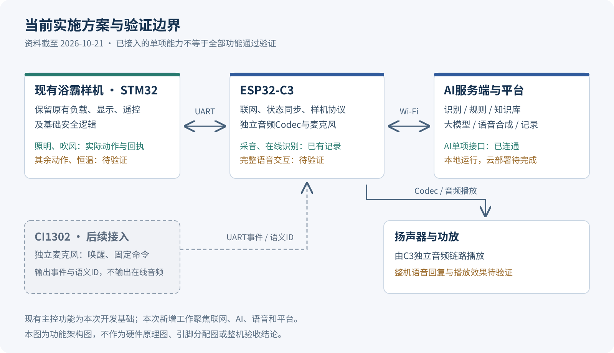

# 东信智能浴霸AI项目技术状态与验证依据

| 项目 | 内容 |
|---|---|
| 文件编号 | DX-RD-STATUS-20261021 |
| 版本 | V1.0 |
| 状态截止日期 | 2026-10-21 |
| 对应用途 | 2026-10-22阶段进度沟通的技术附件 |
| 源码基线 | `55321cb`，2026-10-20提交 |
| 当前实施路线 | 现有STM32主控 + ESP32-C3联网及独立在线音频 + 后续CI1302离线语音 |

## 1. 记录范围

本文件汇总已有研发成果、现存验证依据和后续工作，不构成阶段验收报告。本次整理未连接调试器或串口，未烧录、控制负载、播放音频或调用付费AI接口。

状态用语分别表示：

- **已有实测依据**：项目既有记录明确记载了执行和结果；证据可能为历史技术记录、设备日志或项目主理人反馈。
- **已开发，待验证**：存在对应源码或设计，尚无覆盖目标场景的完整实测记录。
- **待接入或待部署**：依赖实物、资料、外部环境，或仍需继续实现。

单次连通不推导准确率、性能、稳定性或量产容量；模拟命令结果不推导真实负载动作。对历史记录的引用只保留其明确证明的部分。

## 2. 目标与职责

原始需求包括样机联网、自然语言控制、大模型接入、真实人感触发的主动沟通、企业知识库与后台、小程序和测试资料。执行时以合同约定为准，技术路线以[项目执行基线V1.1](../../项目执行基线%20V1.1.md)为准。

现有STM32保留负载、电机、温控、显示、遥控及安全逻辑；C3负责联网、在线音频、协议适配与设备状态同步，服务端负责在线识别、规则、知识问答、大模型和语音合成。后续CI1302只输出唤醒事件和固定命令语义，不承担在线语音PCM采集或任意语句转文字。

旧C3单主控、三颗PCF8574直控及相关硬件输入书属于历史降本预研。其图纸和端口安排不用于当前样机接线或进度认定。



图中“已接入”表示接口或单项能力已有依据，不表示所有功能通过验证；CI1302为后续接入路径。

## 3. 开发成果与验证状态

| 工作项 | 当前实现或成果 | 验证状态及边界 |
|---|---|---|
| C3联网与消息 | Wi-Fi、MQTT注册、状态、命令与回执 | 已有实板通信记录；早期弱暖/强暖成功日志为文本模拟 |
| C3固件工程 | ESP-IDF工程、立创音频板适配、构建烧录入口 | 既有构建、烧录与运行记录；源码版本不直接等于板上版本 |
| 样机串口状态 | 固定32字节帧、校验、解析和状态记录 | 已收到有效真实状态帧 |
| 样机双向控制 | GPIO18发送、GPIO19接收，命令和值及状态匹配确认 | 照明、吹风有实际动作及回执依据 |
| 其余负载 | 协议映射和分级控制入口 | 弱暖、强暖等未形成实测结论；不能按按钮存在认定通过 |
| 恒温 | 保留后续接口和参数工作项 | 当前禁用；不把旧`0x0B`模式命令当作恒温 |
| STM32维护 | AC6工程、串口兼容性修复、备份/烧录/恢复脚本 | 2026-10-20已有备份和烧录记录；主理人反馈“样机正常” |
| 在线录音与识别 | 立创板独立音频Codec、PCM录音和上传 | 已有采集及在线识别实板记录；不构成正式ASR数据集结论 |
| 在线AI服务 | ASR、规则、LLM、TTS及结构化结果处理 | 三类云端服务单项接口有连通记录 |
| 完整语音交互 | 录音→识别→规则/LLM→样机回执→TTS下载播放 | 已开发，真实样机整链效果仍待验证 |
| 知识库 | 分类录入、发布状态、关键词匹配和引用片段、无资料兜底 | 基础实现；正式知识资料未入库，不描述为生产级向量RAG |
| 主动沟通 | 事件入口、模式、间隔、安静时段和建议动作 | 存在基础策略源码；真实人感/雷达及语音、确认动作联调待完成 |
| 微信小程序 | 首页、控制、AI、帮助、设置页面 | 原型含模拟回退；微信身份、绑定、真机端到端待完成 |
| 产品研发中心 | 固件工具、样机监听、AI配置、独立/批量测试、结果导出 | 本地内部研发工具；不是生产交付平台 |
| 设备运营平台 | 设备、日志、知识库、AI运营和系统状态页面 | 本地实现；正式云端尚未部署 |
| 员工登录 | 密码摘要、签名会话、生产配置检查 | 基础代码已实现；不认定已完成生产账号体系验证 |
| 设备认证 | 研发Broker设备凭据及设备Topic校验、生产配置门禁 | 本地研发实现；阿里云IoT每机独立身份待接入 |
| 正式专项测试 | 数据集、任务、复查和CSV/JSON/HTML导出工具与模板 | 成套ASR/LLM/知识库/TTS测试尚未完成，不能给出正式准确率 |
| CI1302 | 离线语音方案、UART事件协议及适配边界 | 模块未到，真实唤醒、固定命令、断网控制待接入 |
| 云端与存储 | 阿里云IoT、RDS、Redis、HTTPS、监控、备份及日志策略设计 | 待实际配置、部署和验证 |

## 4. 可追溯依据

| 编号 | 依据 | 可以支持的结论 | 限制 |
|---|---|---|---|
| REF-01 | [历史验证记录V0.4](../../阶段技术状态与验证记录%20V0.4.md)，2026-09-22 | 类型检查、构建、文本模拟MQTT和三类AI单项接口曾通过 | 绑定历史版本`e4f72d0`；不能当作当前版本重新执行记录 |
| REF-02 | [固件README](../../../firmware/README.md)和[执行基线](../../项目执行基线%20V1.1.md) | 立创板采音和ASR已有记录；样机状态帧、照明和吹风已有实际回执依据 | 属项目汇总记录，未另行保存所有动作的独立原始测试包 |
| REF-03 | 本机`stm32-firmware/device-backups/20261020-171910/manifest.json`及备份日志 | 2026-10-20 17:19原始Flash、Option Bytes及UID备份已生成 | 文件只保存在本机；不包含完整恢复演练结论 |
| REF-04 | 本机`stm32-firmware/release/20261020-180958/manifest.json`及`jlink-flash.log` | 2026-10-20 18:09记录目标STM32F103C8，日志包含下载及Program & Verify成功 | 只能证明记录中的程序写入，不代表所有功能验证 |
| REF-05 | 项目主理人烧录后反馈“样机正常”；本轮确认无新增功能结果 | 可记录为烧录后基本运行正常的人工确认 | 不延伸到暖风、恒温、热安全和长时稳定性 |
| REF-06 | [当前源码提交](../../../README.md) `55321cb` | 追溯本轮材料对应源码内容 | 提交不证明部署、实测或已推送到远端 |
| REF-07 | `scripts/verify-stm32-firmware.mjs`、`firmware/main/stm32_protocol_self_test.c` | 已形成协议与回归检查工具 | 工具存在不替代本轮运行结果；本轮未运行 |

备份记录中的原始64KiB Flash SHA-256：

```text
263CB9BC6F6B792E544520012A551B7F1767F686774FE2CD78E03F3467E3BDC3
```

烧录记录中的源HEX SHA-256：

```text
96007A4250D3479C3823DACB1E65A450129EBFC0E33369E468AEC8FA27E73896
```

两项数值引用既有manifest。本轮未重新读取芯片或对芯片内程序作哈希校验。烧录源HEX属于生成产物，其现存文件可能随之后构建改变，追溯以归档记录和对应源码版本为准。

## 5. 软件与工程入口

| 范围 | 目录或入口 | 当前用途 |
|---|---|---|
| 服务端 | `apps/api/src` | 设备、语音、知识库、登录、测试与运营接口 |
| 共享协议 | `packages/shared/src/index.ts` | 输入输出Schema、设备动作和状态类型 |
| 研发前端 | `apps/development-console/src` | 本地研发与测试 |
| 运营前端 | `apps/operations-console/src` | 后续生产部署基础 |
| C3固件 | `firmware/main`、`firmware/build-and-flash.ps1` | 联网、音频和STM32协议适配 |
| STM32固件 | `stm32-firmware/axent-controller/AXENT-AC6.uvprojx` | 当前维护工程，Arm Compiler 6.24 |
| STM32备份工具 | `stm32-firmware/tools` | 构建、备份、烧录、恢复 |
| 本地设备代理 | `apps/device-agent/src` | 本机串口、构建、烧录任务入口 |
| MQTT研发Broker | `apps/mqtt-broker/src` | 本地设备接入 |
| 小程序原型 | `apps/miniapp` | 原生微信小程序页面与接口原型 |
| 历史兼容代码 | `apps/web`、`apps/mcu-simulator`、旧`uart_bridge`、PCF相关模块 | 保留追溯，不计入当前样机控制主链路 |

C3源码声明版本为`1.1.0-online-voice`。上次设备状态记录版本为`1.0.0-stm32-heater-control`，不能据源码声明认定最新版已刷入C3。本轮没有查询板上版本。

## 6. 接口与安全边界

- 现有样机链路：C3 GPIO18/TX至STM32 WIFI_RX；STM32 WIFI_TX至C3 GPIO19/RX；双方共地。115200 bps、8N1、32字节固定帧。
- 实际命令成功以匹配回执和状态为依据，不能用消息发布成功代替设备执行成功。
- `DX_ENABLE_UART_BRIDGE=0`，历史模拟协议不接入当前样机。
- `DX_ENABLE_PCF8574=0`，当前不采用C3直接驱动功率负载的路线。
- `DX_ENABLE_NTC_CONTROL=0`，缺NTC参数、标定和热安全结果时不启用恒温。
- 当前C3开发配置按阶段开放人工测试，并不表示取暖或全部功能已经验证。
- 音频只由人员显式发起，功放默认关闭、音量受限；批量任务不自动播放、不自动执行取暖负载。
- CI1302与C3只交换事件和固定语义。最终模块码表、接线及组合样板仍需核对。
- 生产仅保存文本和必要元数据、默认90天为目标策略；自动清理及生产环境实施仍待完成。研发录音单独归档。

## 7. 后续任务与依赖

| 顺序 | 工作 | 依赖 | 应形成的材料 |
|---|---|---|---|
| 1 | 完整在线语音与现有样机联调 | 当前立创板和样机；确认实际烧录版本 | 录音、识别文本、语义、设备回执、播报结果和问题记录 |
| 2 | 其余主要动作与边界测试 | 对应样机能力；取暖相关条件由人工确认 | 逐项测试记录；恒温条件未满足继续禁用 |
| 3 | 正式知识库整理和专项测试 | 企业知识、说明书、功能、安装维护、故障码和售后资料 | 来源目录、知识条目、测试数据及结果 |
| 4 | 主动沟通与小程序实机联调 | 真实人感事件、线上或局域网接口、小程序身份与设备关系 | 事件→询问→用户确认→动作记录；小程序真机记录 |
| 5 | CI1302及组合样板联调 | 模块、实际资源包和UART码表 | 唤醒、固定命令、断网、在线回退和会话测试记录 |
| 6 | 运营平台云部署 | 云资源、域名及正式服务账号 | 配置基线、部署说明、监控备份和恢复记录 |
| 7 | 资料归档 | 各项实际记录 | 源码版本、协议、设计说明、测试报告和未关闭问题清单 |

步骤3可在资料到位后与其他研发工作并行。CI1302到位前，现有独立在线音频测试可以继续进行。以上是研发顺序，不是未经评估的交付日期承诺。

## 8. 历史资料差异

旧简报仍有“等待样机”“C3替代主控”等表述；这些不用于本次汇报。`stm32-firmware/README.md`中的“当前AC6产物尚未写入样机”早于10月20日的实际烧录记录，最新状态以第4节归档日志和人工反馈为准。

早期架构图和部分源资料导航仍含C3单主控描述，统一按[技术资料总目录](技术资料总目录.md)标注的适用范围使用。原始需求与商务资料保留原文，本次不改写。

## 9. 本阶段不出具的结论

不出具正式ASR/LLM/知识库准确率、TTS音质与整机播放稳定性、离线唤醒率、浴室噪声性能、全部负载与热安全、长期稳定性、生产容量或量产认证结论。现有测试模板、候选数据集和模拟回退只作为后续研发资料。
