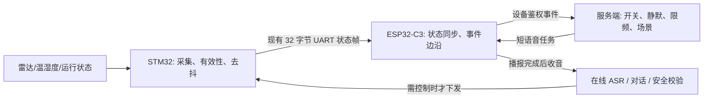

# 主动沟通硬件模拟与传感器接入规范 V0.1

日期：2026-11-09  
状态：软件事件接口与研发模拟已实现；样机传感器装配、STM32 信号源及真实事件上报待东信技术人员确认。本文件是接入设计，不是传感器接线图或整机验收记录。

## 1. 范围与职责

主动沟通采用“硬件事件触发、服务端决定是否播报、用户回应进入在线对话”。不要求大模型自行判断何时开口。现有 STM32 继续负责传感器接入和负载安全；ESP32-C3 负责将有效事件送到服务器及播放在线语音；CI1302 的断网固定词控制不依赖该功能。



### 首版三类场景

| 类别 | 软件事件 | 触发含义 | 默认动作 |
| --- | --- | --- | --- |
| 进入浴室问候 | `OCCUPANCY_ENTER` | 确认“无人→有人”的一次进入 | 简短问候，播完开放回答窗口；不自动开负载 |
| 环境提醒 | `LOW_TEMPERATURE` / `HIGH_HUMIDITY` | 有效测量值跨过双方确定的阈值 | 询问是否需要弱暖/换气；用户确认前不控制 |
| 运行提醒 | `LONG_RUNNING` | 真实运行时长或状态达到双方确定的条件 | 询问是否调整/关闭；用户确认前不控制 |

无人离开只更新状态，不触发问候。静默时间、最小播报间隔、设备忙碌、播报关闭、离线、事件过期时应跳过；不能把重连后的旧事件当成“刚有人进来”。当前服务端事件过期窗口为 30 秒。温湿度未装、无效或未提供时，不播报具体数字；不得用研发模拟值填充真实设备状态。

## 2. 已实现的软件接口

- 研发中心“语音验证 → 主动沟通 · 硬件模拟”可手动选择上述事件，附加模拟温湿度；“预览判断”只计算结果，“播报并收听回答”需人工二次确认。模拟请求不会写真实设备状态，不消耗真实事件的播报限频窗口，不自动发负载命令。研发接口 `/api/development/proactive/simulate` 在生产环境返回 404。
- 真实设备使用已鉴权的 `/api/device/v1/events`，输入包括 `deviceId`、`eventType`、`occurredAt` 和 `payload`。服务端当前可处理进入、低温、高湿和长时间运行事件，返回主动沟通决定，并在条件满足时向具备音频能力的设备发送播报任务。播报完成后进入在线连续会话，直至空闲超时、用户结束语或主动停止；只有明确提出设备动作时才进入安全校验与 STM32 控制。新固件逻辑尚未烧录实测。
- 当前 C3 样机固件没有从真实 STM32 状态帧生成上述传感器事件。研发模拟通过不代表雷达、湿度或运行时长已接通。

示例事件仅定义语义，不包含设备鉴权细节：

```json
{
  "deviceId": "<实际设备编号>",
  "eventType": "OCCUPANCY_ENTER",
  "occurredAt": "<设备校时后的 ISO 8601 时间>",
  "payload": { "hasOccupancy": true, "ambientTemperature": 24, "humidity": 65 }
}
```

只有真实传感器提供且有效的字段才应出现在 `payload`；无湿度模块时省略 `humidity`，不要填 0。事件编号和重试去重需在 C3 实物接入阶段与设备鉴权及 MQTT/HTTP 路径一并冻结。

## 3. 给东信技术人员的硬件与串口输入

东信技术人员先确认雷达/人感模块是否装配、供电与输出电平、信号是否已接入 STM32；提交最终原理图、实际 MCU 引脚或模块 UART 连接、极性、稳定时间和人体进入/离开时的原始观察结果。现阶段不能依据旧板图推定一个具体 GPIO，也不能把 5 V 输出直接接入 3.3 V 输入。

当前样机 C3 适配器读取的 STM32 状态帧为 32 字节，已有温度位于 `byte 8`，CI 事件占 `byte 13–16`，控制版本占 `byte 17`；当前 STM32 发帧程序将 `byte 18–28` 清零，C3 尚未解析这些保留位。建议保留现有帧头、长度、校验和串口 `115200/8N1`，在双方评审后按如下扩展；**以下字节分配为待冻结建议，不是已经烧录生效的协议**：

| 字节（从 0 开始） | 建议含义 | 约束 |
| --- | --- | --- |
| 18 | 扩展版本 `0x01`；`0x00` 为旧帧 | C3 只在版本匹配时解析 |
| 19 | bit0 人感有效、bit1 有人、bit2 温度有效、bit3 湿度有效、bit4 运行时长有效 | “无人”和“传感器未装”不能混为一谈 |
| 20 | 相对湿度，整数 `0–100` | 仅 bit3 有效时使用 |
| 21–22 | 实际连续运行分钟数，小端 `uint16` | 不复用旧 `byte 11` 的剩余时间 |
| 23–24 | 有人进入事件计数，小端 `uint16` | 每次确认进入递增；C3 首包只建立基线，不补播旧事件 |
| 25–28 | 保留 | 不改变现有控制和 CI 字段 |

STM32 负责采样去抖及有效位；C3 收到旧帧或无效传感器字段时维持“未知”，不能当成“无人/湿度 0”。C3 在收到有效进入计数变化时上报一次 `OCCUPANCY_ENTER`；断网时不积压待恢复后播报的旧问候。低温、高湿、长时运行阈值与恢复滞回需双方在真实模块与产品条件确认后冻结，当前不将任意测试值作为量产阈值。异常或故障状态不应自动触发取暖。

## 4. 验证与交付边界

1. 研发中心对三类场景分别测试开关、静默、限频、无传感器值、无回答、拒绝、正常回答及设备忙碌；导出带“模拟”标记的记录。
2. 东信技术人员确认信号源后，先在无负载条件下记录雷达进入/离开、温湿度和运行时长的原始帧；再烧录两端协议适配，验证 C3 只产生一次事件、云端能收到。
3. 人工确认声学与安全条件后，验证真实事件→播报→回答→必要时控制→真实状态回执，并测量附件二约定的响应时间。模拟结果不得计入真实传感器验收。

外部资讯可作为在线对话的内容来源，但不作为传感器接入前置条件。正式接入时应选有使用许可的来源，定时抓取并缓存短讯，保留来源和发布时间；断网或内容失效时跳过，不编造实时新闻，不在每次人感触发时临时抓取。

## 5. 本轮软件验证记录

2026-11-09：API 与研发中心类型检查通过；服务端运行时回归 120 项通过；研发/运营页面浏览器冒烟检查通过；立创 ESP32-C3 固件 `lichuang-build` 编译通过。隔离研发 API（关闭 MQTT、独立数据目录）对进入、低温、高湿和长时运行四种事件分别返回 `shouldSpeak=true`、`actionExecuted=false`。这是软件与页面检查，不含真实雷达、实际播报、在线多轮声学、样机动作或公网联调；本轮未烧录固件。
