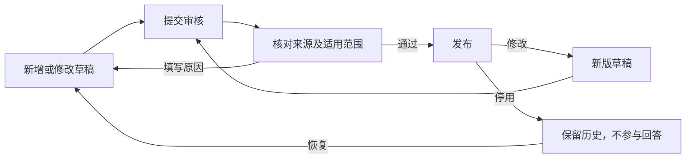

# 企业知识库与 RAG 维护说明 V1.0

更新日期：2026-10-27  
适用范围：东信设备运营平台、在线语音服务的企业知识问答

## 1. 使用入口与本版范围

本地入口：<http://127.0.0.1:3020/#knowledge>。

运营平台的“知识库”分为知识条目、待审核、资料来源、问答测试四个页面。知识维护在运营平台完成；研发中心用于整链路语音及专项测试。

本版采用文字检索与大模型结合的 RAG。2026-10-27 扩充后，本地知识库包含 50 条已发布知识、98 条草稿；已发布标题及等价问法去重后共 195 种。草稿包括本轮从 7 份来源批量提取的 97 段，以及此前保留的 1 条参考型号故障草稿。草稿不参与用户回答，章节和等价问法也不视为独立、已核实的产品事实。

已发布内容以企业背景和浴霸通用知识为主。具体内容及来源见同日的《资料整理与知识库验证记录》。初始化整理标记为 `initial-curation`，不代表企业审核人员已经签审。

当前为本地文件存储实现，服务于资料维护和链路验证。正式云端部署时仍需实施数据库迁移、备份和运行配置；本轮未验证生产规模的并发承载能力。

## 2. 资料适用范围

| 范围 | 用途 | 参与回答的条件 |
| --- | --- | --- |
| 企业背景 | 公司介绍、主营产品、生产与检测条件 | 已发布，来源正文可核对 |
| 浴霸通用知识 | 不依赖具体型号的基础说明 | 已发布，内容不包含未经核实的型号参数 |
| 指定型号 | 该型号的功能、参数、操作说明 | 已发布，且请求中的设备型号与条目适用型号匹配 |
| 内部参考 | 参考产品、旧资料、待核实信息 | 不参与用户回答，也不能直接发布 |

米家 S1、MJYB03YL 文件保持为内部参考，不能转用为当前样机的功能、故障码或售后依据。型号专用来源也不能发布为企业或通用知识。

资料之间出现矛盾时，先保留原文件并记录待核实内容，不合并为一个确定答案。首版未采用存在差异的厂房面积、产能、专利数量，也未将企业宣传中的规划能力写成当前样机已实现功能。

## 3. 维护流程

### 3.1 上传资料与整理正文

在“资料来源”点击“上传资料”，选择文件并填写资料名称、适用范围和版本备注。上传范围默认是“内部参考”；拟用于问答的正式资料应在上传时选择对应范围。

支持 UTF-8 TXT、Markdown、DOCX、PPTX、XLSX 和带可提取文字的 PDF。单文件上限 6 MB，PDF 上限 200 页。旧 DOC、图片及扫描件需要先转换或人工整理；当前未提供自动 OCR。重复上传相同文件会被拒绝。首批登记的本地大文件可直接预览，不受网页新增上传的 6 MB 限制。

上传后可预览提取文字、下载原文件，或点击“整理为草稿”。在“可整理章节”中勾选所需内容，点击“批量整理为草稿”，可以一次整理最多 200 段。PPT 按原幻灯片页码，DOCX 按段落和表格行，XLSX 按工作表及原始行号保留位置；型号来源导入前必须指定适用型号。

重复导入会跳过同一来源中已整理的章节，包括已经人工修改或停用的条目，防止覆盖维护结果。来源文件在预览与导入之间发生变化时，导入请求会被拒绝，需重新预览。批量导入始终生成草稿，内部参考来源不能据此发布。

文件本身不会直接参与回答。文字提取可能丢失表格布局、图示关系等信息，应对照原文件核实。单次提取最多保留 300,000 字及 1,000 段；长段按最多 12,000 字拆分，单条知识正文编辑上限为 30,000 字。空白、短标题、模板占位和重复正文不计入候选章节。

首批资料的目录登记不等于全部内容已经整理。显示“待 OCR 校对”“已登记，未整理”的资料需要补齐可核对正文；素材分组和重复压缩包不提供单文件预览。

### 3.2 新增与修改知识

在“知识条目”点击“新增知识”，或在原文预览中整理为草稿。建议一条知识回答一个明确问题，填写：

- 问题或知识标题、经过核对的正文；
- 企业、通用或指定型号范围，型号资料必须指定适用型号；
- 来源文件以及页码、章节或段落；
- 完全等价的问法和必要检索标签。

等价问法会用于直接回答，只能填写本答案能够完整回答的问题，不能用宽泛标签代替。例如“东信位于哪里”可对应公司所在地；“东信有哪些产品”不应对应某一个型号的参数说明。

保存已发布条目时会生成新草稿，旧版本继续用于回答。相同条目只允许一个待处理草稿或待审核版本。多人同时编辑时，后提交的旧版本请求会被拒绝，应刷新并核对差异后重新保存。

### 3.3 送审、发布与停用

送审及发布前，必须关联可用来源并填写来源位置。审核人员核对正文、适用范围、型号及等价问法后发布；退回时必须填写原因。新版发布后，上一发布版本自动停用。

知识列表支持每页 20、50、100 条及当前页多选。编辑人员可批量送审、停用；审核人员可批量发布。操作只处理所选条目中状态符合要求的项，每条仍执行版本和权限检查；部分失败时显示成功数、失败数及原因。批量发布前应逐条核对来源，不应直接发布整份宣传资料中存在冲突的数字。

删除采用“停用”：即时退出后续检索，保留版本及操作记录。恢复操作生成草稿，需要再次审核发布。条目的“版本记录”可查看各版正文、操作人、操作时间和退回原因。

## 4. 问答处理方式

在线链路先处理固定规则，再查询知识。与已发布问答标题或等价问法完全匹配、且答案长度不超过 600 字时，直接返回答案，不调用 LLM。

其他相关问题按中文文字匹配检索正文片段，将来源标识、来源位置及知识 ID 提供给 LLM。默认最多采用 3 条命中资料，上下文不超过 5,000 字。当前使用文字匹配，不使用向量数据库或 Embedding 服务，因此没有新增该类调用费用。

只有已发布且范围匹配的条目能够参与检索。多轮语音会话中，部分指代性追问可以借用前面的问题找回资料，但不会据此前提生成固定答案。普通闲聊仍可由 LLM 回答。

保修承诺、收费、故障码、电气维修等问题缺少已核对的直接问答时，以及型号参数缺少对应证据时，返回：

> 现有资料还无法确认这个问题。请提供具体产品型号，或联系官方售后核实。

这是保守处理规则，不代表已经建立完整的产品售后知识库。文字匹配分仅用于排序，不是准确率；检索命中也不等于生成答案已经人工审核。

## 5. 问答验证

在“问答测试”输入问题，必要时填写产品型号，然后点击“测试问答”。界面显示回答、FAQ / RAG / 保守答复路径、耗时、来源及检索片段，并可导出本次 JSON 结果。该页面只返回文字。

可先检查：

| 问题 | 当前预期 |
| --- | --- |
| 介绍一下东信 | 已发布 FAQ 直接回答 |
| 东信的企业背景和产品是什么 | 检索资料后交给默认 LLM |
| 东信浴霸免费保修多少年 | 当前资料不足，保守答复 |

RAG 使用研发中心“AI 服务”已配置的真实默认 LLM 和启用提示词；未配置、服务调用失败或模型返回控制动作时，知识问答页返回保守答复。RAG 调用可能产生服务商费用，FAQ 不产生 LLM 调用费用。

研发中心的“整链路语音测试”接入同一套已发布知识；ASR、LLM、TTS 的独立专项测试用于测试单个服务，不能用单独 LLM 测试代替知识库验证。本轮未重新进行麦克风、播报及样机动作实验。

## 6. 员工权限

| 角色 | 知识内容操作 |
| --- | --- |
| ADMIN | 管理员，可执行全部知识操作 |
| EDITOR | 上传、编辑、送审、停用及恢复草稿 |
| REVIEWER | 查看内容、核对来源、发布或退回 |

本地免登录环境使用 ADMIN 身份。正式部署应启用现有运营登录配置：`OPS_AUTH_MODE`、`OPS_ADMIN_USERNAME`、`OPS_ADMIN_PASSWORD_HASH`、`OPS_AUTH_TOKEN_SECRET`、`OPS_CORS_ORIGINS`。密码散列由项目根目录执行 `npm.cmd run auth:hash` 生成，不在配置中存储明文密码。

额外编辑和审核账号通过服务端环境变量 `OPS_KNOWLEDGE_USERS` 配置，内容为 JSON 数组，每项包含 `username`、`displayName`、`role`（`EDITOR` 或 `REVIEWER`）及 `passwordHash`。账号移除或角色变更后，原会话失效。当前没有网页员工账号管理模块，也未实现按部门细分的读取权限。

## 7. 数据迁移与运行限制

知识内容保存在服务端数据目录。默认目录为项目下 `data`，可通过 `DONGXIN_DATA_DIR` 指定。迁移时应停止写入，并完整迁移：

| 文件或目录 | 内容 |
| --- | --- |
| `knowledge-documents.json` | 知识正文、状态及版本 |
| `knowledge-sources.json` | 来源登记与上传文件元信息 |
| `knowledge-seed-state.json` | 首批知识初始化及迁移标记 |
| `knowledge-audit.json` | 操作审计及当时正文快照 |
| `knowledge-files/` | 网页上传的原文件 |
| `system-logs.json` | 平台操作及问答日志 |

首批本地原文件归档于 `D:\workspace\Dongxin-research\01-client-source\ziliao`，没有复制进代码仓库。迁移服务器时，需要单独复制这批资料，并设置 `KNOWLEDGE_SOURCE_ROOT` 指向其根目录，保持相对路径不变；否则这些来源的原文件预览和下载不可用。已整理的知识正文独立保存，原文件不会随每次问答重新提取。

初始知识使用一次性迁移标记，服务重启不会覆盖人工修改。不要删除初始化标记来更新知识，应使用网页流程维护。知识数据和上传文件已排除出 Git，代码仓库不能替代数据备份。

本地实现提供单进程写入排队、版本冲突检查及单文件原子替换，但知识、审计和日志之间尚无数据库事务。不要让多个 API 进程同时写同一个 JSON 数据目录。云端部署前应将这些操作迁移为数据库事务，并制定数据保留、备份及权限策略。
