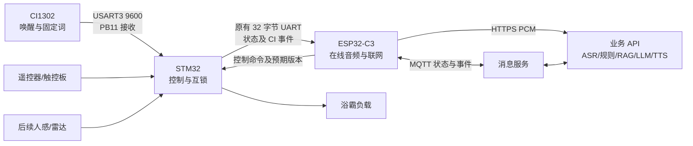

# 样机联调与云端试点执行清单 V1.0

日期：2026-10-31  
状态：代码集成准备；本轮未烧录、未执行样机负载动作、未部署阿里云

## 1. 当前链路和职责

CI1302 只接收并识别固定词，不承担在线原始音频传输。CI 已播报“我在”后，C3 不重复播报；在线麦克风在 CI 唤醒后保留短时音频并行收音。固定词由 STM32 本地执行并回传事件；未命中才走在线 ASR。服务端不能绕过 STM32 安全互锁。

## 2. 本轮可复核的代码结果

| 项目 | 状态 | 验证边界 |
|---|---|---|
| STM32 接收 CI 8 字节帧 | 已实现，放行 ID 1/2/3/8/9/10/11；8–11 仅按实际烧录包映射 | Keil AC6 构建通过，新增词码尚未烧录或实测；取暖等其余词码继续拒绝 |
| STM32 经原 32 字节帧上报 CI 事件与控制版本 | 已实现 | C3 协议自检和构建通过，尚未实物联调 |
| C3 固定词/在线录音仲裁 | 已实现首版 | 每句固定词判定窗口、固定词只结束当前句、CI 播报回声抑制已过构建/服务端测试；双麦时序、回声、超时仍需实测 |
| 研发中心断网等预设 | 已实现纯推演 | 不会实际断网或下发负载动作 |
| 主动沟通平台触发 | 已实现 | 按钮播报需人工确认；无自动负载动作 |
| 真实传感器事件到设备播报 | 服务端路径已接入 | 无传感器样板；尚未实物验证 |
| 主动沟通播报后收音/确认 | 已实现首版 | 仅在开发板报告播报完成后开启短窗；实物声学仍待测 |
| 云端十万台规模持久化 | 未完成 | 仍为本地 JSON 和进程内状态，不得宣称生产可用 |
| PostgreSQL 首版表结构、迁移器及设备/命令仓储 | 已准备 | 语音文本历史可选切至 PostgreSQL；设备/命令等运行路径未切换，尚未在阿里云 RDS 执行 |

当前只验证了编译与自动化测试，不能代替设备执行、安全、声学和并发验收。实际烧录包 V0.4 的 8–11 已加入非加热命令白名单；4–7 取暖词码及其他未确认动作继续拒绝，待主控安全与逐条实物结果确认后再扩展。具体模拟验证见《reports/2026-11-02/合同指标本地模拟验证记录.md》。

2026-10-31 软件补充：设备命令回执已通过原子状态转换处理并发冲突和重复上报；最新状态的 PostgreSQL 仓储及运营 SQL 聚合已完成数据库替身测试。定时完整状态核对在状态未变化时不再产生历史事件；待确认命令不再计入已完成命令。运行时测试现为 87 项、数据库测试 21 项。以上均未切换运行中 API 至 RDS，也未产生样机动作。

2026-10-31 身份补充：HTTP 与 MQTT Broker 增加可选的 RDS 逐设备凭据摘要校验，附带受控设备灌装命令及网关身份隔离。运行时测试累计 88 项、数据库测试 25 项、Broker 鉴权测试 4 项。仍未灌装真实设备、连接 RDS 或解除生产启动门禁。

2026-10-31 文本补充：RDS 文本会话仓储和分批 90 天清理命令已完成数据库替身测试；数据库测试累计 31 项。实际语音业务尚未接入该仓储，清理命令仅运行了不连接数据库的计划模式，不能据此认定对话记录已在 RDS 持久化或清理任务已上线。

2026-10-31 时序补充：CI 固定词在连续会话的任意一句命中时，C3 取消该句的在线处理并继续监听，直至会话空闲超时；播报中命中本地命令会中止当前 C3 播放。服务端忽略 CI “我在”提示被 C3 麦克风误录后的二次回答，但该句若送至 ASR 仍会产生识别调用。C3 对重复 CI 事件不重复仲裁，但仍处理帧中的状态。当前运行时测试 89 项、数据库测试 31 项通过；C3 固件构建、STM32 静态协议检查、工作区类型检查、研发/运营页面与小程序巡检通过。此记录不包含新固件烧录、真实双麦声学、负载或云数据库验收。

2026-10-31 云端准备补充：设备 PCM 接口只接受 16 kHz、16-bit、单声道完整采样，最长 13 秒；无效格式、空数据、半帧或超长数据在 ASR 前拒绝，13 秒包含 C3 最长 12 秒说话及短时预录余量。设备语音文本历史增加可选 PostgreSQL 运行路径，写入文本、路由、时延和费用，历史页可分页查询；默认本地 JSON。运营平台可显示实际文本历史后端，并在 PostgreSQL 模式提示另行安排定时清理。运行时测试累计 95 项、数据库测试 32 项通过，其中 HTTP 注入验证覆盖无效 PCM 的返回码、设备语音服务测试覆盖实际写入路径。尚未连接真实 RDS、部署云服务器或验证实际音频质量。

2026-10-31 事件幂等补充：数据库新增 `002_local_event_identity` 迁移及按设备事件编号唯一索引，本地动作的 PostgreSQL 仓储事务可一次完成查重、状态写入和控制版本推进；数据库替身测试累计 37 项。此仓储尚未接入运行中的 API，生产门禁保持关闭。C3 离线暂存和重连补报改为沿用首次事件编号，重连先补报再订阅下行；固件已构建但未烧录。离线期间 C3 仅保留最近一条 CI 本地状态，必须在现场测量断线、多次本地动作、重连和 QoS 1 重传的时序；这些软件检查不等于整机验收。

2026-10-31 MQTT 时序复核：C3 本地事件补报改为等待 QoS 1 发布确认，四个下行订阅均收到确认后才开放命令处理；断线前队列内的旧连接消息在重连后丢弃。立创 C3 固件仅构建通过，STM32 协议静态检查通过，尚未烧录或做真实 broker 断线测试。暂存事件仍只在 C3 内存中，掉电和长时间断网的逐条审计不在当前保证范围；运行中 API 仍采用本地 JSON 与进程内控制版本，不能据此解除生产门禁。

2026-10-31 命令时效补充：服务端下行命令同时携带 ISO 时间与 `expireAtUnixMs`；C3 在 MQTT 和 HTTP 轮询执行前检查该时间戳。首次上电尚未通过阿里云 NTP 同步、时间戳缺失、已过期或异常过远时，只拒绝远程命令并回传拒绝原因；CI1302 经 STM32 的本地固定命令不依赖联网校时。新逻辑仅完成固件构建和自动化检查，尚未烧录或测量现场 NTP 可达性。现场先在无负载条件下确认校时成功、有效命令能执行、过期命令不能执行，然后再进入有人值守的负载测试。

本轮复核记录（2026-10-30）：STM32 AC6 编译为 0 错误、0 警告；立创 C3 ESP-IDF 构建通过；工作区 8 个 TypeScript 项目类型检查通过。运行时自动化测试 86 项、独立数据库仓储/迁移测试 13 项、知识库测试 33 项、小程序测试 4 项通过；研发/运营界面、知识库、语音与运行状态页巡检通过。设备命令回执在 JSON 仓储中改为原子终态转换，并与 PostgreSQL 仓储一致地拒绝待确认命令的设备回执；冲突回执不会覆盖已确认状态，重复回执保持幂等。服务端设备播报增加了停止与回执竞态保护，并将播报结束后的单次回答收音作为独立状态，收音结束即关闭确认窗口；STM32 不再对已分配给 CI1302 的 USART3 执行旧 RS485 发送使能/延时，C3 重复事件判定包含词码与事件类型。C3 心跳改为 15 分钟并随机错峰，完整状态定时核对改为每小时并随机错峰，连接及状态变化仍即时上报。上述结果不包含新固件烧录、真实负载动作或 RDS 实例验证。

## 3. 样机联调顺序

1. 东信技术人员复核 CI1302 TX→STM32 PB11、共同地、供电与 3.3V 电平，确认 PB10 不向 CI 发送旧 RS485 业务帧；断电检查后上电。先记录当前已运行固件版本和备份。
2. 在不连接负载或使用安全观察点的条件下，烧录 STM32 和 C3 的新版本；读取 CI 唤醒、照明开/关的原始 8 字节帧和 C3 收到的 32 字节回传。确认一条语音只出现一次有效事件。
3. 有人在场时只测试照明开、照明关和状态回传。按“CI 本地执行→STM32 真实状态→C3 取消对应在线控制→平台记录”核对时间顺序。其他词码、吹风、取暖、恒温暂不借用 ID 2/3 推断。
   同时记录每句说完到 CI 事件到达 C3 的间隔，覆盖连续会话第二句及第三句；核对 700 ms 等待窗是否足够，特别检查事件恰好遇到云端回复或 TTS 播放时是否仍播出过期回答。
4. 在确保设备处于安全状态后，分别测试 Wi-Fi 断开、API 停止、MQTT 断开与恢复；离线照明应继续本地执行，恢复后旧在线命令不得重放。记录本地事件编号、补报结果和首次下行订阅时间；在断线期间连续执行开灯/关灯时，最终状态须与样机一致，不要求云端补出每条离线动作历史。研发中心的断网预设仅用于纯推演，不算此项实物验证。
5. 验证开放式问题的在线 ASR→RAG/LLM→TTS 与连续会话；测试 CI 已播报“我在”时 C3 不重复播报、固定词命中不产生 ASR/LLM/TTS 调用、固定词之后下一句仍可继续对话，并测量 CI 播报进入 C3 麦克风的程度。若回声已送至 ASR，虽可阻止二次 LLM/TTS 回答，仍应记录识别费用。
6. 真实人感/雷达样板到位后，再上报带当前时间的进入事件；验证安静时段、最小提醒间隔、设备忙碌/离线抑制、播报完成后 30 秒确认窗，以及拒绝/超时/本地控制时不执行建议动作。涉及取暖的确认动作最后测。

烧录和负载动作必须由现场人员在确认接线、供电和安全后发起；本清单不授权远程自动操作样机。

## 4. 云端试点前置门禁

1. 取得阿里云账号、杭州 ECS、域名/证书、数据库与 MQTT 产品的实际规格及访问权限，再冻结公网地址与证书链。不要把现有 `app_config.h` 的开发 Wi-Fi、IP、共用测试密钥直接烧给量产设备。
2. 替换本地 JSON/进程内关键业务状态，至少完成按设备存储的身份、状态、命令及回执、事件、审核知识文档、员工审计和 90 天文本留存；数据库迁移、备份和恢复演练通过后才能进入生产试点。
3. 每台设备独立灌装 ID 和密钥；MQTT 与音频 HTTPS 均验证设备身份。员工登录与设备身份分离；生产数据库不开放公网。小程序需要正式 AppID、微信登录和单设备归属校验，不能复用研发或员工接口。
4. 用少量样机试点测量心跳量、语音峰值、队列等待/拒绝、ASR/LLM/TTS 费用及失败回退，再决定是否增加 ECS 规格或消息/模型配额。十万台是规划目标，不是本轮已验证规模。

生产持久化、逐设备量产灌装、正式云资源、消费者小程序和实物联调仍是开放项。运营平台当前显示的运行数据只反映本地试点环境。
