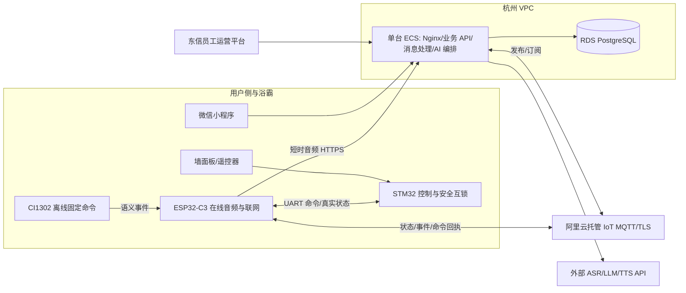

# 东信智能浴霸生产云端架构设计草案 V0.1

日期：2026-10-26  
状态：设计草案，尚未购买服务器和域名，未部署或完成容量验证  
依据：《项目执行基线 V1.1》及 `docs/reference/project-source` 中的项目需求和验收资料。旧 C3 单主控、PCF8574 直控方案不作为本次实施依据。

## 1. 范围与原则

本方案覆盖合同所需的在线 AI 语音、知识库、主动沟通、设备接入、消费者微信小程序、东信内部运营平台及其服务器和数据库。当前样机保持 **STM32 负责浴霸控制和安全互锁、ESP32-C3 负责联网与在线音频、后续 CI1302 负责离线唤醒和固定命令**。云服务不得替代 STM32 的实时温控及硬件保护。

按首年预计投入约 10 万台设备规划接入与扩展路径，实际入网数量和在线比例仍需以销售及试点数据校准。10 万台设备不是 10 万路并发语音，也不代表已通过容量测试。首期只实现合同功能，采用单台 ECS 上的模块化单体和少量独立进程，不引入微服务集群、Kafka、Kubernetes、通用智能家居平台或家庭共享。微信小程序属于合同交付范围，但当前明确延后，不阻塞设备、服务端和内部运营平台建设。

研发环境继续使用本地 Broker 和 JSON 数据；生产数据只在阿里云测试/生产环境的数据库中建立和迁移，本机不安装生产数据库。

## 2. 目标拓扑

阿里云 IoT 平台优先作为生产 MQTT 接入候选，需在采购前核对所选地域、实例能力、设备数、连接数、消息计费、上下行限制和服务等级。仓库内 Aedes Broker 只用于本地研发，不按 10 万设备规模自行运营。音频不通过 MQTT 传输；在线录音走独立的受限 HTTPS 请求，完成 ASR 后即丢弃原始音频，不写入对象存储或日志。

首发生产环境采用杭州地域单台 ECS，不预购第二台 ECS、负载均衡或 Redis。Nginx 在该机终止 HTTPS；API、设备消息处理与 AI 编排分进程运行，ASR/LLM/TTS 使用外部 API，不在 ECS 部署推理模型或 GPU。关键业务数据由 VPC 内的 RDS PostgreSQL 持久化，数据库不得暴露公网。研发环境继续留在本地；云端试点转生产时须隔离或清理测试数据，并更换 IoT 产品/凭据、密钥及模型额度，不能让测试流量影响生产。大规模压测可短期另开资源，测试结束后停用，不作为常驻采购项。

单台 ECS 是成本优先的生产起点，不是高可用架构。它故障、维护或所在可用区异常时，在线语音和运营平台可能中断；墙面板、遥控器、STM32 本地控制和后续 CI1302 离线命令必须继续可用。应用代码保持无状态边界，以便实测达到瓶颈或业务要求更短恢复时间时，再增加第二台 ECS、负载均衡以及所需的共享限流/缓存。扩容依据实际在线设备数、消息峰值、语音并发、延迟和故障恢复要求，而非设备注册总数。

采购时先比较杭州 ECS 2 核 4 GB 与 4 核 8 GB 两档，Ubuntu LTS、40~80 GB ESSD 系统盘；试点可从 2 核 4 GB 起步，若正式负载压测达标则沿用，否则升级到 4 核 8 GB 或实测所需规格。公网带宽按流量计费并设置费用告警，峰值带宽依据音频大小和试点实测确定，不以 1 Mbps 固定带宽作为语音服务基线。RDS PostgreSQL 从满足备份与容量要求的入门规格询价，存储按预计 90 天文本量和试点增长量选择可扩容档位；是否选高可用版取决于可接受的数据库停机时间和报价。以上只是询价和试点规格，不构成 10 万台规模的性能承诺；购买前还要核对 IoT 配额、外部模型并发额度和完整月度费用。

## 3. 必要业务链路

### 3.1 设备身份与用户归属

每台 C3 在制造/烧录环节取得唯一 `deviceId` 和独立 `deviceSecret`，通过 MQTT/TLS 向 IoT 平台认证，首次联网后在业务数据库登记。设备自动注册**不等于**自动绑定消费者。小程序使用 `wx.login` 取得微信身份，再扫码机身二维码申请绑定未归属设备；二维码仅包含公开设备标识和一次性绑定凭证，不包含 `deviceSecret`。第一版一台设备仅有一位归属用户，不做家庭共享或手机号验证码。已归属设备不能被重复扫码抢占；换绑需原用户解绑或经过有审计记录的售后处理。

设备报文必须绑定已认证的设备身份，不信任载荷中自报的 `deviceId`；在线音频 HTTPS 入口也要验证同一设备身份。消费者接口每次校验当前用户与设备归属。员工令牌、消费者会话和设备密钥分开签发，不能互用。

### 3.2 状态、控制与回执

设备状态变化立即上报；后台维护每台设备最新状态和最后通信时间。小程序或在线语音发起控制时，API 先校验身份、设备归属、已装配能力和安全规则，再在同一数据库事务中写入带唯一 `commandId`、短时有效期的命令和待发布记录；消息进程可重试发布，避免“命令已入库但进程重启导致未下发”。MQTT QoS 1 只表示消息至少一次送达 Broker，不表示浴霸执行成功。C3/STM32 返回匹配的真实执行回执后才能记为 `APPLIED`；重复投递按 `commandId` 幂等处理。超时、拒绝和执行失败分别记录，界面不得把“已下发”写成“已执行”。

设备离线时不积压取暖等危险动作；一般动作也必须有明确过期时间。无论云端输出什么，STM32 现有安全互锁仍是最后执行边界。墙面板、遥控器及离线固定命令在断网时继续工作，并在恢复连接后同步真实状态。

### 3.3 在线 AI 与主动沟通

CI1302 离线固定命令在本地处理，不调用云端。未命中的在线语音由 C3 的独立音频通道送 ASR；文本优先走确定性规则和已审核知识库，无法处理时再调用 LLM，最后执行结构化结果校验和安全规则。TTS 只对需要播报的文本调用。各外部模型设置超时、并发/费用上限与失败回退，网络或模型不可用时不得以猜测结果控制负载。

在线语音按全局并发上限接入，超额请求仅进入有长度和最大等待时间限制的短队列；等待超时或队列已满时明确返回“服务繁忙，请稍后再试”，不积压录音，也不无限占用连接或内存。短队列只能平滑突发，不能增加持续处理能力；持续到达量超过处理量时必须限流，并以拒绝率作为扩容依据。语音会话是短时任务，进程重启时允许丢弃未处理请求并由设备提示重试；设备控制命令则必须先持久化到 RDS，并以过期时间和幂等回执处理，不能和语音等待队列混用。首发单进程统一执行语音准入限制，后续多实例时再引入跨实例限流。并发数、队列长度和等待时限依据外部 API 配额、成本上限及端到端延迟压测确定，不能凭 10 万台设备数预设。

人感/雷达只上报有意义的状态变化和事件。主动沟通按用户设置、安静时段、频率限制及当前设备状态决策；涉及负载动作先询问用户，不直接开高功率功能。知识库资料由员工审核发布并保留版本；缺少可靠依据时给出保守回答，不编造售后规则。

## 4. 数据与消息量

RDS PostgreSQL 是设备、消费者归属、命令及回执、已审核知识文档、主动沟通设置、员工账号和审计记录的事实来源。最小表域包括消费者、设备、单设备归属、最新设备状态、命令、待发布记录、知识文档及版本、主动沟通设置、员工账号、审计记录和文本日志。每台设备的最新状态独立存储，不能沿用当前单实例全局状态。命令和文本日志先按时间索引并按已确认保留期分批清理；若试点数据量证明需要，再进行时间分区迁移，不把每条心跳当作永久历史记录。首发不采购 Redis；短时语音准入在单个 AI 处理进程内实现，关键业务状态、幂等依据及命令不能只存在内存。需要多实例或实测证明在线态/限流有瓶颈时再评估 Redis。文本对话与必要操作日志按默认 90 天保留；原始语音不留存。数据库备份和恢复演练是上线条件。

仅以 10 万台全部在线设备计算，应用层心跳每 30 秒一次约为 **3,333 条/秒、2.88 亿条/天**；每 15 分钟一次约为 **111 条/秒、960 万条/天**，尚未计入状态变化、指令和 AI 请求。这是极端在线率下的心跳估算，不是语音并发。因此不能把每次心跳都写入永久事件表或全部保留为 90 天日志。优先利用托管 IoT 的连接事件判断在线状态。当前 C3 固件把应用心跳设为 15 分钟并随机错峰，完整状态定时核对为 1 小时并随机错峰；连接与状态变化仍即时上报。试点中须验证离线发现时延和费用，传感器抖动须在设备侧去抖/限频。最终心跳周期和消息预算要以阿里云实际计费及试点数据冻结。

消费者登录峰值、设备同时在线率和每秒语音会话数尚无实测值。AI 供应商 QPS、并发和成本通常比普通 API 更早成为瓶颈，必须分别压测 API、MQTT 消息处理、命令回执及 ASR/LLM/TTS，不能用“10 万注册用户”直接推断某一服务器规格。

## 5. 安全与运维底线

- 仅 HTTPS/TLS 对外；RDS 不暴露公网，启用数据库和备份静态加密。应用按最小权限访问资源，密钥保存在云端密钥服务或受控环境变量，不进入小程序包、前端静态文件或 Git。
- 小程序使用微信身份和设备归属鉴权；运营平台仅东信员工账号密码登录，至少具备登录限流、会话过期、操作审计和离职账号停用。测试/生产管理员账号分离。
- 设备接入使用每设备独立密钥、主题权限、消息大小限制、频率限制、时间戳/序号或命令 ID 防重放。量产烧录和密钥补发须有受控流程。
- 生产 API、消息进程、数据库、IoT、ASR/LLM/TTS 监测错误率、语音队列长度/拒绝率、命令待发布积压、回执超时、在线率、调用量和费用，并设置告警。关键变更可回滚；定期备份并实际做一次恢复演练。
- 只采集完成业务所必需的信息。微信小程序上线前完成主体、域名、隐私说明及相关备案/合规检查；用户文本记录按已确认的 90 天策略清理，敏感标识在日志中脱敏。

## 6. 界面和部署实施顺序

1. **资源采购前**：冻结设备身份、命令/回执、按设备状态和员工运营权限的服务端契约；收紧公开设备接口、单实例状态与本地数据源等生产边界。整理阿里云资源规格、费用估算和部署清单，但不购买或部署。研发中心继续留在本地。
2. **内部运营平台**：沿用现有总览、设备、告警/日志、知识库、AI 运营和系统状态六个方向；先完成页面和接口契约，云资源到位后接入真实按设备数据、知识版本发布与审计。固件烧录、串口监听、硬件实验只在本地研发中心保留。
3. **阿里云试点环境**：在采购和访问权限确认后准备杭州 VPC、域名与证书、单台 ECS、RDS PostgreSQL 和 IoT 接入；部署 API、消息进程与语音准入，完成数据库迁移、备份、监控和凭证隔离。数据库只在此阶段建立，不要求本机数据库。试点转生产前更换测试凭据并清理测试数据；不常驻第二套云环境。
4. **设备与云端试点**：先完成少量样机端到端联调，再做批量连接、心跳、控制回执、断线重连、模型限流和故障恢复压测；根据实测扩容到量产目标。CI1302 到货后另行验证离线语音，不作为当前云端设计的前置条件。
5. **消费者小程序（延后）**：在设备归属、消费者鉴权、正式 AppID 和 HTTPS 域名具备后，再完成微信登录、扫码绑定、我的设备、真实状态、基础控制/回执、文字 AI 问答、知识帮助与主动沟通设置。不做支付、家庭共享、售后工单或完整运营商城；不能把员工 API 直接开放给小程序。

## 7. 当前代码与目标的差距

当前 `apps/mqtt-broker` 为本地明文 TCP Broker；设备 HTTP 接口已加入逐设备鉴权，但凭据仍由环境变量集中配置；`apps/api/src/storage.ts` 使用本地 JSON。`getDeviceState(deviceId)` 已按设备隔离，但状态与控制版本仍只驻留进程内存，重启后丢失。小程序仍是测试 AppID 和固定测试设备，缺少微信登录与归属校验。因此现有代码只能用于研发联调和有明确设备数量上限的单实例样机试点，**不得直接公网部署并宣称量产可用**。生产化应逐项替换并通过安全与容量门禁，而不是整体重写已验证的业务逻辑。

## 8. 决策待确认

- 服务器和域名目前均未购买。后续采购前需确认阿里云账号、地域、IoT 平台实例与预算上限，并核对实时产品配额和计费。
- 微信小程序当前延后。启动该阶段前再确认主体、正式 AppID 与开发者权限；AppSecret 不通过聊天或仓库传递。
- 上线目标时间、可接受的单机故障恢复时长与数据库恢复点，以及真实的试点设备数量/预计语音使用量，用于冻结采购规格、模型配额和压测目标。
- 东信最终产品说明书、安装维护、故障码和售后规则，用于知识库审核发布。
