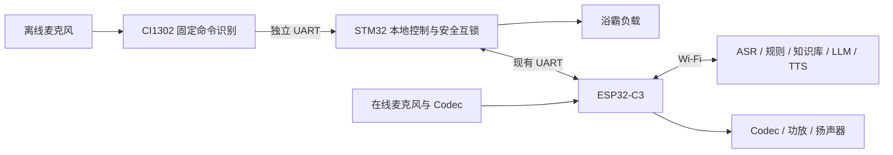

# 东信智能浴霸 AI 项目执行基线 V1.2

更新日期：2026-10-30
状态：当前执行基线；为保持已有链接，保留 V1.1 文件路径

## 1. 执行目标

本次研发以合同已经约定的智能浴霸能力为范围，在东信现有样机和稳定 STM32 控制程序基础上增加联网、在线 AI 语音、离线语音及运营平台能力。项目不重复开发样机已经稳定工作的负载、电机、温控、显示、遥控和安全互锁。

优先级依次为：打通 STM32 与 ESP32-C3、打通在线语音闭环、完成可追溯测试、接入 CI1302 离线语音、完成云端运营平台生产化。

## 2. 当前架构

### 2.1 职责边界

| 模块 | 当前职责 |
|---|---|
| STM32 | 保留现有控制和安全逻辑，直接接收 CI1302 固定命令；统一处理离线语音、遥控、面板和 C3 在线控制并上报真实状态 |
| ESP32-C3 | 联网、MQTT、在线语音、AI结果校验、设备状态同步和 STM32 协议适配 |
| CI1302 | 负责“小东小东”常驻唤醒和固定命令识别，经 UART 接 STM32；固定命令联网与断网均在本地执行，不传输 PCM 或任意文本 |
| 独立音频Codec | 为C3提供独立麦克风PCM和扬声器播放通路，首版与CI1302采用双麦克风 |
| 服务端 | ASR、低成本规则、知识库、LLM、TTS、设备接入、日志和运营管理 |

### 2.2 不采用的当前路线

- 不以 ESP32-C3 直接替换现有 STM32；
- 不在 C3 重写已稳定的浴霸负载状态机；
- 不将 3 颗 PCF8574 直控方案作为当前合同实施基线；
- 不以 ESP32-S3 作为量产首选，仅保留研发对照；
- 不等待 CI1302 才开展联网、在线语音和 STM32 协议研发。
- 不依赖CI1302输出PCM或任意自然语言文本；CI1302与C3之间不使用I2S音频链路。
- 不再把“CI1302 经 C3 才能控制 STM32”作为实施路线；C3 或云端异常不得阻断离线固定命令。

## 3. 当前真实状态

### 3.1 已验证

- ESP32-C3 SuperMini 已完成 Wi-Fi、MQTT、文本模拟命令和回执闭环；
- 立创 ESP32-C3 音频板可在 COM5 构建、烧录并运行；
- 立创板麦克风 PCM 采集和在线 ASR 链路已有实板记录；
- ASR、LLM、TTS 服务已分别完成接口连通验证；
- STM32 `WIFI_TX → C3 GPIO19` 已收到并校验 32 字节状态帧；
- C3 `GPIO18 → STM32 WIFI_RX` 已接通，照明和吹风已取得真实状态回执并完成实际动作闭环；
- 在线语音固件已贯通录音上传、ASR、规则/LLM、STM32真实回执判断和短期TTS音频下载播放；
- CI1302 独立开发板已实测唤醒和照明开/关，串口仅确认语义 ID 1/2/3；CI 与 STM32 已完成接线；
- 本地研发中心、运营平台、API 和 MQTT 基础服务可构建。

### 3.2 当前限制

- 旧 `uart_bridge` 为 V0.2 模拟协议，与当前样机不兼容；
- 除已记录的照明和吹风外，其余真实负载动作由研发人员自行验证，未形成记录前不得标记为已验证；
- 在线语音代码已完成，但真实 ASR → 规则/LLM → STM32 → TTS 整链路效果仍由研发人员手动验收；
- CI1302 独立开发板可唤醒和识别首轮固定词；但 CI → STM32 → C3 的新版固件尚未烧录及实物联调，不能给出样机离线控制结论；
- STM32 与 C3 的 CI 事件扩展已编译并通过协议自检，仍需实物验证时序、去重和真实状态回传；
- 正式 ASR、LLM、知识库和 TTS 数据集测试尚未完成；
- 运营平台仍为本地预生产实现；本轮加入单进程限流排队、调用量、短回复缓存与文本清理。生产鉴权及独立设备凭据尚需实际部署验证，数据库迁移和容量测试未完成。

## 4. 研发顺序

| 阶段 | 工作 | 完成判据 |
|---|---|---|
| P0 | 执行基线收敛 | 代码、页面和文档统一采用 STM32 + C3 + 后续CI1302 |
| P1 | 联网与消息 | C3稳定连接Wi-Fi/MQTT并完成注册、心跳和回执 |
| P2 | STM32只读接入 | 真实状态帧可稳定收取、校验、解析和记录 |
| P3 | STM32双向控制 | 独立协议适配器通过测试，低风险单动作和真实回执完成验证 |
| P4 | 在线语音闭环 | C3独立Codec录音、ASR、规则/知识库/LLM、结构化结果、TTS和设备命令贯通 |
| P5 | 合同数据集 | 批量测试结果可追溯、可导出，重要输出满足合同边界 |
| P6 | CI1302离线语音 | CI1302 已接 STM32；完成新版固件烧录后，验证断网及 C3 异常时固定命令仍可执行，在线离线去重和状态回传通过实物验证 |
| P7 | 生产平台 | 云端鉴权、设备独立凭据、数据库、调度、监控及文本保留策略完成部署与验证；按实测负载确定容量 |

## 5. 当前接线和安全门禁

- 当前已验证公共地和 `STM32 WIFI_TX → C3 GPIO19` 接收链路；
- GPIO18用于 `C3 TX → STM32 WIFI_RX`，必须断电接线；
- 双向链路使用115200 bps、8N1和32字节固定帧，命令只有取得匹配回执才成功；
- 当前开发固件控制阶段为3，协议支持的负载可供有人值守手动验证；该配置不代表各负载已经通过验收；
- 恒温继续受 `DX_ENABLE_NTC_CONTROL=0` 门禁保护，未取得NTC参数、标定数据和热安全结果前不得开启；
- 不复用或直接启用旧 `uart_bridge`；
- 取暖等危险负载不得进入无人值守或自动批量动作测试；
- 音频不得在上电、刷新或任务启动时自动播放，只能人工点击并采用受限音量。

## 6. 两套平台边界

### 6.1 东信产品研发中心

本地研发工具，不作为东信生产系统交付。仅保留：研发总览、样机联调、固件与烧录、AI服务配置、在线语音、批量测试与报告。样机控制按钮按C3固件注册的真实能力分级开放，禁止仅在网页解除危险负载门禁。

### 6.2 东信设备运营平台

后续部署到东信云服务器，面向内部员工。当前保留：运营总览、设备管理、告警与日志、知识库、AI运营和系统状态。当前采用单服务器方向，不因预计首年销售10万台而直接配置10万路语音并发。上线前完成员工鉴权、设备独立身份、HTTPS、生产数据库、监控和数据保留策略；RDS、Redis及托管IoT是否采购按实际部署方案决定。

## 7. 当前交付与非交付

当前可交付：本执行基线、已经验证的软件和接口记录、现有协议分析、在线语音设计、测试计划与空白测试模板、运营平台部署准备代码。

当前不能写为已完成：未留存证据的STM32负载控制、CI1302离线语音、正式AI准确率、真实取暖与热安全、生产平台容量及正式云部署。上述内容必须在实际执行并取得证据后形成报告。

CI1302与在线音频的详细边界以《CI1302经STM32接入与在线离线协同 V1.0》为准。原《CI1302离线语音与独立在线音频方案 V1.0》和《ESP32-C3与CI1302通信协议 V2.0》中的直连拓扑已被替代。CI1302 PCM输出不再是项目阻塞项，也不得作为首版硬件成立的前提。

CI1302 开发板已到并与 STM32 接线，P4 仍使用立创板独立 Codec 提供真实 PCM、ASR、规则/知识库/LLM 和受控 TTS 手动验收入口；研发中心的“模拟 CI 唤醒后在线回退”只替代 UART 唤醒事件，不能形成整机唤醒率、离线识别率或抗噪声结论。

研发中心现已支持把立创板静音采集的PCM自动封装为WAV并归档到ASR测试集。该能力用于完成P4/P5的在线ASR数据准备，不改变CI1302相关项目仍待实物验证的状态。

## 8. 历史方案处理

《C3单主控系统架构与职责边界》《DX-AI-01 Rev.A硬件设计输入书》、PCF8574端口图、C3直控安全状态机及相应旧路线图仅作为降本预研和历史追溯资料，不得用于指导当前样机接线、固件发送或项目完成度判断。

合同原始资料位于 `docs/reference/project-source`，保持原文，不因本次技术收敛而修改。

## 9. 本轮软件实施范围

服务端已加入有界语音队列、ASR/LLM/TTS分级并发、取消和超时检查、请求去重、调用量及估算费用、短回复内存缓存、文本保留和运营状态面板。数据文件通过单进程事务及原子替换写入。

本地操作事件到达服务端后，即使操作未改变状态，也会使此前生成或排队中的在线控制失效。该保护不代替 STM32 的最终仲裁；网络延迟期间的冲突必须由设备侧控制序号解决，待 CI1302 实物接入时实现并验证。

运行参数、数据边界及软件验证入口见《单机语音调度与数据保留说明 V1.0》。本轮不包含真实设备动作、CI1302烧录、付费语音实验或云端部署。
